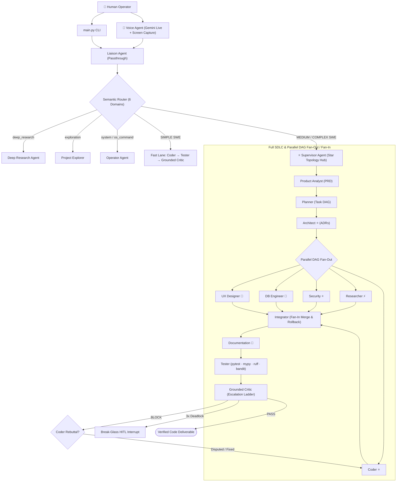
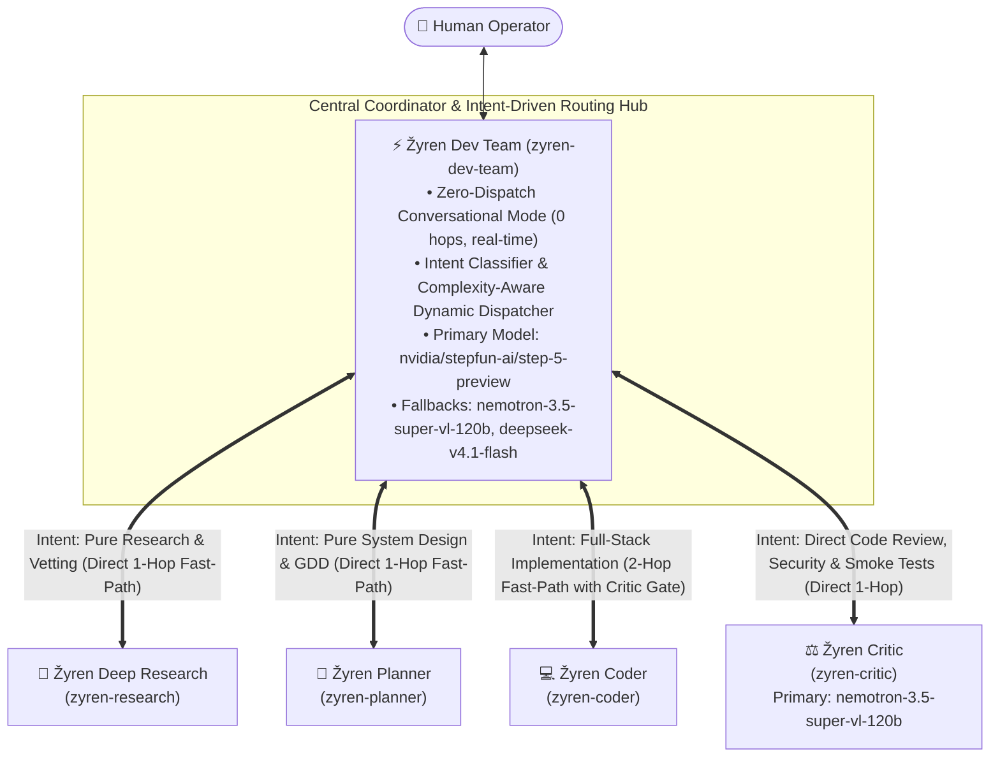

<p align="center">
  
</p>

<p align="center">
  
  
  
  
</p>

# Engineering Autonomous Multi-Agent Software Swarms: Field Notes from Five Architectural Iterations

**Personal Engineering Notes & Case Study on Swarm Topology, Coordination Trade-Offs, Horizontal vs. Vertical Decomposition, Execution-Based Verification, and Migrating to OpenCode V2**

* **Author / Brand:** Žyren (MONaser04)
* **Brand Clarification:** *Žyren* is the author's universal engineering, software development, and gaming brand across all digital platforms. It is not the name of an individual software architecture or standalone project; rather, this paper documents an evolving multi-system engineering journey conducted under the Žyren brand across five successive generations—evolving from a bespoke 20-agent Python monolith through **ŽyrenClaw** (OpenClaw) to its active Generation 5 port on **OpenCode V2**.
* **Date:** October 2026 (Updated November 2026)
* **Verified Reference Repositories & Execution Environments:**
  1. **Generation 1 (17+3 Agent Star-Topology SDLC Engine):** [MONaser04/Zyren-AI-Dev-Team-I](https://github.com/MONaser04/Zyren-AI-Dev-Team-I)
  2. **Generation 2A (Domain-Agnostic NVIDIA NeMo Execution Chassis):** [MONaser04/Zyren-NeMo-Chassis](https://github.com/MONaser04/Zyren-NeMo-Chassis)
  3. **Generation 2B (Dual-Brain Multimodal Liaison & Switchyard Router):** [MONaser04/Zyren-AI-Dev-Team-II](https://github.com/MONaser04/Zyren-AI-Dev-Team-II)
  4. **Generation 3 & 4 (Production Autonomous Engineering Runtime):** **ŽyrenClaw** (Decoupled OpenClaw Architecture + **LangClaw** `v0.4.0` Sidecar Prototype + 5-Agent Vertical Topology) — *Archived Scaffold: [`scaffolds/openclaw/`](scaffolds/openclaw/README.md) in this repo*
  5. **Generation 5 (Coding Harness Migration — OpenCode V2):** **Žyren on OpenCode V2** ([MONaser04/Zyren-AI-Dev-Team](https://github.com/MONaser04/Zyren-AI-Dev-Team) — Decoupled TypeScript Engine + Electron Desktop Harness + Native Agent Skills Specification + Unified Live Voice Chat & UFO `gemini-3.8-live` Computer Use + Structured LangGraph MCP/Skills in `scaffolds/opencode/`) — *Replacing custom Node daemon plumbing with native background service execution, progressive skill disclosure, bidirectional OpenCode Live Voice Chat + desktop vision control, and a preliminary end-to-end Python CLI canary (`task-cli`).*

> [!NOTE]
> **Scope & Methodological Note (Personal Field Notes — Not Universal Laws):**  
> This repository documents Mohamed Abouzaid's personal engineering experiments, iterative prototypes, and small-scale canary runs — not universal prescriptions or formal large-scale benchmarks. Quantitative claims below are separated strictly into: (1) published research measurements with explicit arXiv citations and scope (`arXiv:2512.08296`, `arXiv:2601.10560`, `arXiv:2605.22721`, `arXiv:2603.22651`, `DeLM`), (2) directly verifiable codebase and artifact counts on disk, and (3) qualitative observations from solo prototyping.

---

## Abstract

A widespread assumption in agentic system design is that increasing the number of specialized agents linearly improves software engineering capability. In my own experiments across five iterative setups under the **Žyren** engineering brand, adding more specialized agent roles did not automatically produce better software: multiplying agent handoffs increased coordination overhead, cumulative context drift, and interface contract mismatches when tasks were split horizontally across role boundaries. Published scaling benchmarks (Kim et al., Google Research/MIT, `arXiv:2512.08296`) similarly report that multi-agent gains depend heavily on task structure — ranging from `-70.0%` to `+80.8%` overall, with `-39.0%` to `-70.0%` degradation on sequential planning (`PlanCraft`) and `17.2×` error amplification in independent setups vs. `4.4×` under centralized coordination.

This case study documents my personal engineering notes across five iterative setups built under the **Žyren** brand:
1. **Generation 1 (`Zyren-AI-Dev-Team-I`):** A Python monorepo (`23,050` lines across `100` files in `src/`, `19,373` non-empty lines) featuring **17 specialized SDLC agent roles** (+ 3 operational agents), a **LangGraph Supervisor Star Topology**, a **6-Domain Semantic Router**, **SmartGateway** with **Bayesian Thompson Sampling** across **10 LLM provider adapters**, and **29 offline test suites**.
2. **Generation 2 (`Zyren-NeMo-Chassis` & `Zyren-AI-Dev-Team-II`):** A modular infrastructure chassis built for the **NVIDIA NeMo / NIM ecosystem** and **NVIDIA AI Workbench** using lightweight local SQLite WAL state with inference offloaded to cloud NVIDIA NIM endpoints, paired with a **Dual-Brain Liaison Agent** combining a **Google Gemini Live API Voice Facade** (`gemini-3.1-flash-live-preview`) with an **NVIDIA Nemotron Reasoning Core** (`nvidia/nemotron-3-ultra-550b-a55b`).
3. **Generation 3 & 4 (`ŽyrenClaw`):** A return to **OpenClaw**, customized at the CLI and UI layers into **ŽyrenClaw** without forking upstream OpenClaw's core runtime, paired with the **LangClaw** state/memory prototype, and simplified into a **5-agent Hub-and-Spoke setup** organized around **Vertical Feature Slicing (Walking Skeletons)** and an **execution-based Critic gate**.
4. **Generation 5 (`OpenCode V2`):** A migration from general automation gateways to **OpenCode V2 (v2.4.x)** as a dedicated software engineering harness—eliminating custom daemon scripts and SQLite lock contention, using the **Agent Skills standard (`SKILL.md`)** with progressive disclosure, integrating unified **Live Voice Chat & Windows Computer Use** (`Microsoft UFO` + `gemini-3.8-live` + OpenCode REST/SSE bridge) plus **LangGraph** remote MCPs (`langchain-docs` / `langchain-reference`), and completing an initial end-to-end Python CLI canary (`task-cli`, N=1) prior to future SWE-bench testing.

---

## ⚡ Executive Blueprint & Evolutionary Journey (At a Glance)

> **Quick Summary:** If you do not want to read the full architectural case study, this matrix summarizes my personal field notes across five iterations — moving from an initial 20-agent Python prototype to the current 5-agent OpenCode V2 setup.

### The Complete Evolutionary Journey Matrix

| Phase / Era | Core Architecture & Scale | Key Innovation & Tech Stack | Crucial Lesson / Failure Mode Overcome | Production Artifacts & Status |
| :--- | :--- | :--- | :--- | :--- |
| 🏛️ **Gen 1: Bespoke SDLC Prototype** | **20 Agent Roles** (17 SDLC + 3 Ops) in a LangGraph Star Topology | • Built from scratch (**23,050 lines across 100 Python files in `src/`**)<br>• Custom SmartGateway with Thompson Sampling<br>• 29 offline test suites | ❌ **Coordination Tax & Context Drift:** Passing context across 17 specialist boundaries led to cumulative context drift and heavy multi-hop token overhead. | 📦 **Status:** [Zyren-AI-Dev-Team-I](https://github.com/MONaser04/Zyren-AI-Dev-Team-I)<br>*(📦 Archived)* |
| 🧠 **Gen 2: NVIDIA NeMo & Dual-Brain** | **Consolidated 2-Tier Hierarchy** (SQLite WAL local state + cloud NIM offload) | • Native **NVIDIA NIM & AI Workbench** integration<br>• Dual-Brain: Gemini Live Voice Facade + Nemotron 550B Ultra Reasoning | ⚠️ **Plumbing vs. Runtime:** Validated voice streaming and dual-tier routing, but lacked a native interactive coding CLI harness. | 📦 **Status:** [Zyren-NeMo-Chassis](https://github.com/MONaser04/Zyren-NeMo-Chassis) & [Zyren-AI-Dev-Team-II](https://github.com/MONaser04/Zyren-AI-Dev-Team-II)<br>*(📦 Archived)* |
| ⚙️ **Gen 3: Forging ŽyrenClaw** | **Decoupled Upstream Wrapper (Zero-Fork Runtime)** + **LangClaw** State Sidecar | • Decoupled UI & CLI branding (`zyrenclaw.ps1`)<br>• **Upstream updates preserved (no core fork)**<br>• SQLite episodic vector memory prototype | ❌ **Horizontal Layer Trap:** Splitting frontend, backend, and storage across separate agents caused DOM ID and contract mismatches. | 🔄 **Status:** [MONaser04/Zyren-AI-Dev-Team](https://github.com/MONaser04/Zyren-AI-Dev-Team)<br>*(📦 Archived Gen 3/4 Baseline — `scaffolds/openclaw/openclaw.example.json`)* |
| 🚀 **Gen 4: Lean 5-Agent Topology** | **Strict Hub-and-Spoke** (Coordinator, Researcher, Planner, Coder, Critic) | • **Vertical Feature Slicing (Walking Skeletons)**<br>• **Deterministic Runtime Smoke Gate (`exec`)**<br>• Unified Full-Stack Coder | ✅ **Fewer Merge Breaks:** 3 self-contained canary deliveries (`modern-fruit-catcher`, `cat-playground`, `neon-void`) completed via closed-loop Critic self-repair. | 🎯 **Status:** `benchmarks/` (`modern-fruit-catcher/`, `cat-playground/`, `neon-void/`)<br>*(✅ Canary Verified)* |
| 👑 **Gen 5: OpenCode V2 Migration** | **OpenCode V2 (v2.4.x) 5-Agent Port** (`scaffolds/opencode/`) | • Native TypeScript background service (`opencode serve`) + Desktop/TUI<br>• First-Class **Agent Skills Standard** (`SKILL.md`) with Progressive Disclosure<br>• Persistent Session Protocol (`zyren-sessions.md`) & MCP extensibility | ✅ **Fewer Daemon Drops:** Replaced custom Node.js gateway wrappers, SQLite lock contention, and startup prompt bloat in OpenClaw, verified via an initial CLI canary (`task-cli`, N=1). | 🚀 **Status:** [`scaffolds/opencode/`](scaffolds/opencode/README.md) & [`benchmarks/task-cli/`](benchmarks/task-cli/README.md)<br>*(✅ Active Setup — Preliminary Canary Validated)* |
| ⚡ **Gen 4 Stress Experiment: Multi-Hour Endurance Run** | **Long-Horizon Build** (`grand-project`) | • **Elevated Session Timeout** (`timeoutSeconds: 36000`)<br>• **State-Anchored Protocol** (`PROGRESS.md` on disk against Compaction Cliff)<br>• Host memory caps configured via `.wslconfig` | ⚠️ **Exposed Daemon Contention:** Extended local runs tested disk-anchored `PROGRESS.md` persistence while surfacing OpenClaw daemon fragility that motivated moving to OpenCode V2. | 📦 **Status:** Local stress experiment (not bundled in repo)<br>*(📦 Archived Gen 4 Experiment)* |
| 💎 **Track 1: Local Code Intelligence Tools** | **AST + Call-Graph + NVIDIA Nemotron Embed & Rerank** | • `code-outline`: structural AST & lexical outline without loading full bodies<br>• `code-graph`: static cross-file caller & `--impact` check<br>• `code-search`: two-stage **NVIDIA Nemotron-3.5-Embed-8B & Nemotron-3.5-Rerank-8B** | ✅ **Lower Context Bloat:** Python CLI utilities implemented and tested locally on repo files. | 🛠️ **Status:** `scaffolds/tools/` (`code-outline`, `code-graph`, `code-search`)<br>*(🛠️ Local CLI Tools)* |
| 🧠 **Role-Scoped Memory & Post-Mortem Capture** | **Role-Private Notes (`DecentMem` inspiration) + 3072D Vector Index (`gemini-embedding-2`)** | • Configured **Google Gemini Embedding 2** (published spec: 3072 dims, 8192-token context, CoIR 84.0) via `sqlite-vec`<br>• Hybrid search (0.7 vector + 0.3 BM25) + MMR diversity<br>• Role-specific markdown logs (`critic-rules.md`, `dev-gotchas.md`, `research-patterns.md`, `architecture-contracts.md`) | ✅ **Defect Note Persistence:** Tested recording Critic-caught physics/coordinate gotchas into durable markdown memory in `cat-playground`. | 🎯 **Status:** `benchmarks/cat-playground/`<br>*(✅ Canary Tested)* |
| 🛡️ **Reliability Guardrails & Host Resource Governance** | **Two-Strike Write-First Contract + Circuit Breaker + WSL2/RAM Governance** | • **Two-Strike Retry Budget** for missing disk writes + transient error retry caps<br>• Host RAM governance via `.wslconfig` memory caps (`autoMemoryReclaim=gradual`, `sparseVhd=true`), orphaned MCP cleanup, and Edge `--app` mode<br>• Cross-project session isolation & disk-proof reads | ✅ **Practical Guardrails:** Codified loop caps and host memory hygiene rules that reduced local hangs during extended sessions. | 🚀 **Status:** Documented in `scaffolds/openclaw/AGENTS.md` & `scaffolds/opencode/AGENTS.md`<br>*(📝 In-Repo Guardrails)* |
| 🎙️ **Unified Live Voice Chat & Computer Use (Microsoft UFO + `gemini-3.8-live`)** | **Singleton Voice/Vision Daemon + REST/SSE 7-Agent Bridge + 16-Tool MCP (`zyren-ufo`)** | • Bidirectional **Live Voice Chat** in OpenCode Desktop (`zyren-live-voice` via Main IPC + `opencode_bridge.py` REST/SSE async dispatch, spoken completions, voice permission replies & run interrupts across all 7 agents with English/Arabic aliases)<br>• Fast **`gemini-3.8-live`** UIA Set-of-Mark desktop control (`zyren-ufo` MCP, `codemode: false`, `pool: true`, FIFO lock & safety pause gate; atomic `ufo_*` fallback when voice is off) | ✅ **Conflict-Free Voice & Screen Control:** Eliminated dual-voice collisions, Electron CORS/CSP blocks, UIPI admin elevation, and Code Mode invisibility; passed `34` unit/integration tests + live MCP capture check. | 🚀 **Status:** [§8.3](#83-unified-live-voice-chat--windows-computer-use-via-microsoft-ufo--gemini-38-live-integrated) & [`scaffolds/opencode/skills/computer-use/`](scaffolds/opencode/skills/computer-use/SKILL.md)<br>*(✅ Integrated & Active)* |
| 🕸️ **Structured LangGraph Stack** | **Live Official Remote MCPs + Progressive `SKILL.md` Workflow** | • `langchain-docs` (`docs.langchain.com/mcp`) + `langchain-reference` (`reference.langchain.com/mcp`) with `pool: true`<br>• Global `langgraph/SKILL.md` (`StateGraph`, `Command`, `Send`, `interrupt()`, checkpointers, `BaseStore`) | ✅ **Up-to-Date Graph Scaffolding:** Live API grounding + zero turn-zero bloat via progressive skill disclosure; verified connected on OpenCode v2.4.1. | 🚀 **Status:** [§8.4](#84-structured-langgraph-integration-on-opencode-v2-integrated) & [`scaffolds/opencode/skills/langgraph/`](scaffolds/opencode/skills/langgraph/SKILL.md)<br>*(✅ Integrated & Active)* |

---

### Three Patterns That Worked in My Iterations

```
┌────────────────────────────────────────────────────────────────────────┐
│                        Žyren Dev Team (Coordinator Hub)                │
└───────┬───────────────────┬───────────────────┬──────────────────┬─────┘
        │                   │                   │                  │
        ▼                   ▼                   ▼                  ▼
┌──────────────┐    ┌──────────────┐    ┌──────────────┐   ┌───────────────┐
│ zyren-research│   │ zyren-planner│    │ zyren-coder  │   │ zyren-critic  │
│ Deep Research │   │ Architecture │    │ Full-Stack   │   │ Zero-Trust    │
│ & Benchmarks │    │ & Blueprints │    │ Vertical Dev │   │ Runtime Gate  │
└──────────────┘    └──────────────┘    └──────┬───────┘   └───────▲───────┘
                                               │                   │
                                               │  Code Deliverable │
                                               └───────────────────┘
                                                  (Mandatory Audit:
                                                   exec + code-graph)
```

1. **Vertical Slicing Inside One Coder Role**  
   In my runs, dividing UI, logic, and storage across separate agents produced mismatched DOM IDs and broken contracts. Keeping all layers inside a single full-stack role (`zyren-coder`) to build a runnable **Walking Skeleton** first—then layering features slice by slice—worked far more reliably.

2. **Two-Layer Verification: Static Checks + Real `exec` Gate (`zyren-critic`)**  
   Text-only LLM self-reviews repeatedly missed runtime crashes in my experiments. Pairing lightweight static checks (`code-graph --impact` for caller/symbol impact) with real command execution (`node --check`, Python syntax checks, contract assertions, and bounded smoke runs exiting `0`) caught bugs before handoff.

3. **Local Code Intelligence Utilities (`scaffolds/tools/`)**  
   To avoid loading large source files verbatim into every agent turn:
   • `code-outline` extracts classes, methods, signatures, and line ranges using Python's stdlib `ast` module and JS/TS lexical parsing without dumping function bodies.  
   • `code-graph` traces cross-file callers and dependencies statically without an LSP daemon.  
   • `code-search` combines **NVIDIA Nemotron-3.5-Embed-8B** and **NVIDIA Nemotron-3.5-Rerank-8B** with local SHA-256 SQLite caching for English and Arabic code retrieval.

---

### Repository Structure & Quick Start

| Path | Role | Highlights |
|---|---|---|
| [`scaffolds/opencode/`](scaffolds/opencode/README.md) | **Gen 5 Production Runtime (OpenCode V2)** | `opencode.example.jsonc` (agents + `zyren-ufo` & LangChain MCPs), `AGENTS.md`, `skills/` (`computer-use`, `langgraph`), and `/build`, `/audit`, `/plan`, `/research`, `/voice` |
| [`scaffolds/tools/`](scaffolds/tools/README.md) | **Code Intelligence Tools (Python CLI)** | `code_outline.py` (zero-dependency AST/lexical outline), `code_graph.py` (`--impact` caller graph), `code_search.py` (NVIDIA Nemotron Embed & Rerank) |
| [`scaffolds/openclaw/`](scaffolds/openclaw/README.md) | **Gen 3/4 OpenClaw Reference (Archived)** | `openclaw.example.json`, legacy `AGENTS.md`, `SOUL.md`, `CRITIC_SOUL.md`, and gateway scripts |
| [`benchmarks/task-cli/`](benchmarks/task-cli/README.md) | **Gen 5 Flagship CLI Benchmark** | Zero-dependency Python CLI built autonomously on OpenCode V2 + [`DESIGN.md`](benchmarks/task-cli/DESIGN.md) + [`SESSION_TRACE.md`](benchmarks/task-cli/SESSION_TRACE.md) |
| [`benchmarks/`](benchmarks/README.md) | **Full Empirical Benchmarks & Audits** | Gen 4 WebGL/Canvas2D microcosms (`modern-fruit-catcher`, `cat-playground`, `neon-void`) + Critic audit reports |

#### 60-Second Quick Start

```powershell
# 1. Run the Gen 5 autonomous CLI benchmark built by the OpenCode V2 collective
$env:PYTHONPATH = "benchmarks/task-cli"
python -m taskcli --help

# 2. Deploy the OpenCode V2 5-agent collective (copy into project .opencode/ or ~/.config/opencode/)
# See scaffolds/opencode/README.md for global & project-local setup instructions
```

---

### Quick Navigation Index
- [1. Generation 1: Building a 20-Agent SDLC Engine from First Principles](#1-generation-1-building-a-20-agent-sdlc-engine-from-first-principles)
- [2. Generation 2: The NVIDIA NeMo Ecosystem & The First Consolidation](#2-generation-2-the-nvidia-nemo-ecosystem--the-first-consolidation)
- [3. Generation 3: Evaluating NemoClaw & Forging ŽyrenClaw](#3-generation-3-evaluating-nemoclaw--forging-žyrenclaw)
- [4. Evolutions Inside ŽyrenClaw: From 7-Node Intermediate Setup to the 5-Agent Hub-and-Spoke Topology](#4-evolutions-inside-žyrenclaw-from-7-node-intermediate-setup-to-the-5-agent-hub-and-spoke-topology)
  - [4.3 Engineering Anti-Fragility: Circuit Breakers, Polyglot AST, & Cognitive Model Tiering](#43-engineering-anti-fragility-circuit-breakers-polyglot-ast--cognitive-model-tiering)
- [5. Two Practical Turning Points: LangClaw & Vertical Slicing](#5-two-practical-turning-points-langclaw--vertical-slicing)
- [6. Canary Calibration & Cross-Generational Notes](#6-canary-calibration--cross-generational-notes)
- [7. Generation 5: Migrating My Workflow to OpenCode V2 (v2.4.x)](#7-generation-5-migrating-my-workflow-to-opencode-v2-v24x)
  - [7.5 Preliminary Canary Trace: Autonomous Delivery of `task-cli`](#75-preliminary-canary-trace-autonomous-delivery-of-task-cli)
- [8. Engineering Subsystems & Future Architectural Roadmap](#8-engineering-subsystems--future-architectural-roadmap)
  - [8.3 Unified Live Voice Chat & Windows Computer Use via Microsoft UFO + Gemini 3.8 Live (Integrated)](#83-unified-live-voice-chat--windows-computer-use-via-microsoft-ufo--gemini-38-live-integrated)
  - [8.4 Structured LangGraph Integration on OpenCode V2 (Integrated)](#84-structured-langgraph-integration-on-opencode-v2-integrated)
  - [8.5 Upcoming Milestones: Distributed Systems & SWE-bench Benchmarking](#85-upcoming-milestones-distributed-systems--swe-bench-benchmarking)
- [9. Citation & Attribution](#9-citation--attribution)

---

## 1. Generation 1: Building a 20-Agent SDLC Engine from First Principles

### 1.1 Initial OpenClaw Friction & The First-Principles Imperative
The journey began with early builds of OpenClaw. At the time, manual installation presented significant friction, and early versions lacked granular controls for custom model injection, multi-provider fallback chains, and explicit reasoning/thinking depth configuration. Rather than accepting those limitations, OpenClaw was temporarily shelved in favor of engineering a complete multi-agent software development lifecycle (SDLC) engine from scratch to master every layer of multi-agent infrastructure: state sourcing, routing, sandboxing, memory, and verification.

### 1.2 Verified Repository Metrics & Stack (`Zyren-AI-Dev-Team-I`)
* **Repository:** [MONaser04/Zyren-AI-Dev-Team-I](https://github.com/MONaser04/Zyren-AI-Dev-Team-I)
* **Development Stack:** Engineered iteratively using **Antigravity** (Google Gemini and Anthropic Claude models) and **Cline** in VS Code (NVIDIA NIM Endpoints), backed by **Python 3.11+ (`uv`)**, **LangGraph**, and **Docker Compose** (`Postgres`, `Qdrant`, `LiteLLM`, `Jaeger`, `Langfuse`).
* **Codebase Scale:** **23,050 lines of Python source code** (**19,373 non-empty lines**) across **100 Python files** in `src/` spanning 10 core packages (`orchestrator`, `agents`, `gateway`, `contracts`, `state`, `resilience`, `memory`, `tools`, `verification`, `observability`) — **168 Python files / 39,875 total lines** repository-wide including `tests/`, `evals/`, `optim/`, and `scripts/` — paired with **29 offline test suites** in `tests/` (running without live API calls via `MockGateway`, `MockProviderAPIs`, and `MockEventStore`).

### 1.3 Complete Verified Agent Roster (17 Specialized SDLC Roles + 3 Operational Roles)
Inspection of `src/agents/` (23 Python modules) establishes the exact agent roster implemented in Generation 1:

#### A. The 17 Specialized SDLC Roles
| # | Agent Role | Source Module | Primary Responsibility & Contract | Architectural Notes |
|:---:|---|---|---|---|
| 1 | **Supervisor** | `src/agents/supervisor.py` | Central LLM-driven dynamic routing hub | ⭐ Central node in LangGraph Star Topology |
| 2 | **Product Analyst** | `src/agents/product_analyst.py` | Translates user prompt into `ProductRequirementDoc` (PRD), user stories, acceptance criteria | First stage of Full SDLC lane |
| 3 | **Planner** | `src/agents/planner.py` | Converts PRD into `TaskDAG`, dependencies, and agent assignments | Generates DAG structure |
| 4 | **Architect** | `src/agents/architect.py` | Produces `ArchitectDesign`, system components, and ADRs | ⭐ Equipped with Dedicated Critic |
| 5 | **UX/UI Designer** | `src/agents/ux.py` | Generates `UXDesign`, design tokens, and accessibility rules | 🔀 Conditional (frontend/full-stack only) |
| 6 | **DB Engineer** | `src/agents/db_engineer.py` | Produces `DataSchema`, table designs, and migrations | 🔀 Conditional (persistence tasks only) |
| 7 | **Coder** | `src/agents/coder.py` | Core code producer (`CodePatch`) + right of rebuttal (`RebuttalRequest`) | ⭐ Equipped with Dedicated Critic |
| 8 | **Tester** | `src/agents/tester.py` | Executes `pytest`, `mypy`, `ruff`, `bandit` via `src/verification/` | Emits facts-only `VerificationReport` |
| 9 | **Grounded Critic** | `src/agents/critic.py` | Evaluates `VerificationReport` + rubric to issue `ReviewDecision` (`PASS`/`BLOCK`) | Cross-model family + 3-step Escalation Ladder |
| 10 | **Integrator** | `src/agents/integrator.py` | Parallel DAG Fan-in merge reconciliation + automatic checkpoint rollback on failure | Convergence point after parallel Fan-out |
| 11 | **Security** | `src/agents/security.py` | OWASP Agentic Top 10 review + SAST analysis (`SecurityReport`) | ⭐ Equipped with Dedicated Critic |
| 12 | **Documentation** | `src/agents/docs.py` | Milestone-based docs: post-architecture ADRs (`docs_adr`) + post-integration final docs | 📍 Triggered only at milestones |
| 13 | **Liaison** | `src/agents/liaison.py` | Natural-language human interface passthrough & system action parser | 👤 Sole human operator entry point |
| 14 | **Researcher** | `src/agents/researcher.py` | On-demand resolution of technical knowledge gaps during SDLC execution | ⚡ Triggered dynamically on demand |
| 15 | **Professional Researcher** | `src/agents/professional_researcher.py` | Documentation verifier using **10 official provider doc fetchers** (plus shared `base.py` in `src/agents/researcher_docs/`) | 🔬 Cross-validates model specs & citations |
| 16 | **Deep Research** | `src/agents/deep_research.py` | Open-web multi-hop investigation and data aggregation (`ResearchReport`) | 🌐 Uses MCP web/search tools |
| 17 | **Project Explorer** | `src/agents/explorer.py` | Read-only codebase graph and repository structure analysis (`file_list`, `file_read`) | 🔍 Used for `EXPLORATION` routing |

#### B. Additional Operational & Self-Improvement Agents
| # | Agent Role | Source Module | Primary Responsibility |
|:---:|---|---|---|
| 18 | **Operator** | `src/agents/operator.py` | System administration (`system_command` / `os_command`): add, disable, or enable models and set routing defaults |
| 19 | **Voice Agent** | `src/agents/voice_agent.py` | Real-time voice interaction via **Google Gemini Live API** paired with live screen capture (`src/tools/screen_capture.py`) |
| 20 | **Optimizator** | `src/agents/optimizator.py` | Closed-loop self-improvement orchestrator (`optim/`): evaluates runs, analyzes failure patterns, and tunes prompts via **DSPy MIPROv2 / GEPA** |

*(Supporting factory module: `src/agents/critic_factory.py` dynamically instantiates role-specific critics for the three high-risk roles: Coder, Architect, and Security).*

### 1.4 Orchestration & Gateway Architecture in Generation 1
Unlike naive linear chains, `Zyren-AI-Dev-Team-I` implemented two distinct routing layers:

1. **Orchestration Layer (`src/orchestrator/graph.py` — 1,147 lines & `semantic_router.py`):**
   - **6-Domain Semantic Router:** Classifies incoming requests across `software_engineering`, `deep_research`, `media_production`, `conversational`, `system_command`, and `os_command`.
   - **Complexity Sub-Routing & Dual-Track Execution:** Within `software_engineering`, tasks are sub-classified into:
     - **Fast Lane (`SIMPLE` + high confidence):** Routes directly through `Coder` → `Tester` → `Grounded Critic`.
     - **Full SDLC Lane (`MEDIUM` / `COMPLEX`):** Routes through the **Supervisor Star Topology** (`Product Analyst` → `Planner` → `Architect` → **Parallel DAG Fan-out** across `UX`, `DB Engineer`, `Security`, `Researcher`, and `Coder` → **Fan-in** at `Integrator` → `Docs` → `Tester` → `Grounded Critic`).
   - **Grounded Feedback Loop & Right of Rebuttal:** Grounded in MIT Press/TACL research demonstrating that LLMs cannot reliably self-correct without external signals, the `Tester` executes real tools (`pytest`, `mypy`, `ruff`, `bandit`) first. If the `Grounded Critic` issues a `BLOCK` (using a 3-tier escalation ladder: *Soft* → *Firm* → *Hard*), the `Coder` can exercise a **Right of Rebuttal** (`RebuttalRequest`) once per iteration if the critique is a false positive. Unresolved deadlocks after 3 iterations trigger the **Human-in-the-Loop Break-Glass Protocol** (`src/orchestrator/hitl.py`).

2. **SmartGateway & Bayesian Model Routing (`src/gateway/smart_gateway.py` — 735 lines):**
   - All LLM calls pass through `SmartGateway` and `AutoModelRegistry` (`model_registry.py`, 814 lines) supporting **10 Provider Adapters** (`OpenAI`, `Anthropic`, `Google Vertex`, `NVIDIA NIM`, `Azure OpenAI`, `AWS Bedrock`, `Ollama`, `Together AI`, `Fireworks AI`, `Groq`).
   - **6-Factor Routing & Thompson Sampling:** `SmartRouter` selects models based on Task Complexity, Required Capabilities, Cost Budget (`CostTracker`), Availability (`CircuitBreaker`, `FallbackChain`, `RateLimiter`, `HealthMonitor` in `src/resilience/`), Manual Overrides, and **Bayesian Model Quality Tracking** (`bayesian_tracker.py`), which maintains a `Beta(α, β)` distribution per model calibrated offline against an **80-question golden dataset** (`golden_dataset.json`).



### 1.5 Why Generation 1 Prompted Architectural Rethinking
Building `Zyren-AI-Dev-Team-I` from scratch gave me hands-on experience with event-sourced state (`src/state/`), Pydantic v2 contracts (`src/contracts/schemas.py`, 796 lines), MCP tool wrappers (`src/tools/`), Qdrant + semantic memory (`src/memory/`), and OpenTelemetry GenAI tracing (`src/observability/`). However, operating a 17-to-20 agent roster in practice exposed clear scaling friction:
* **Coordination Overhead & Latency:** Routing across up to 17 specialized roles—even with a central Supervisor and Fast/Full lanes—added heavy token overhead and high end-to-end latency in inter-agent serialization before producing working application files.
* **Context Degradation Across Handoffs:** Passing specifications from `Product Analyst` → `Planner` → `Architect` → `UX` / `DB` / `Coder` → `Integrator` introduced cumulative semantic loss.

---

## 2. Generation 2: The NVIDIA NeMo Ecosystem & The First Consolidation

### 2.1 Embracing NVIDIA NIM Blueprints & AI Workbench
Driven by a deep technical affinity for NVIDIA's AI ecosystem—and a commitment to iteratively rebuild from the ground up whenever a cleaner architecture emerges—the next phase focused on leveraging official NVIDIA libraries, NIM inference blueprints, **NVIDIA AI Workbench**, and **Docker Desktop** to construct a streamlined, enterprise-grade foundation optimized for **NVIDIA NIM Endpoints**.

This phase was split into two repositories: first building a reusable, domain-agnostic execution chassis (**`Zyren-NeMo-Chassis`**), and then building the multi-agent software team on top of it (**`Zyren-AI-Dev-Team-II`**).

### 2.2 Generation 2A: `Zyren-NeMo-Chassis` (The Domain-Agnostic Plumbing)
* **Repository:** [MONaser04/Zyren-NeMo-Chassis](https://github.com/MONaser04/Zyren-NeMo-Chassis)
* **Core Philosophy:** Pure infrastructure plumbing with zero hardcoded business logic, designed to keep local state lightweight (SQLite WAL on budget 16GB RAM / GTX 1650-class hardware) by offloading heavy inference to cloud NVIDIA NIM endpoints.
* **Verified Subsystems (`src/` & `config/`):**
  1. **Immutable Pydantic v2 Contracts (`src/contracts/`):** Content-addressed `ArtifactItem` (with automatic SHA-256 checksum deduplication), `NodePayload` envelopes with `correlation_id` tracking, `ExecutionSignal` (`CONTINUE`, `HALT`, `RETRY`, `BRANCH`), `ValidationDecision`, and discriminated unions (`polymorphic.py`: `NIMModelInput`, `RepoSourceInput`).
  2. **SQLite WAL Event-Store & Session Recovery (`src/state/`):** Asynchronous `aiosqlite` event store in Write-Ahead Logging (WAL) mode (`event_store.py`) implementing the `nemo-rl-session-memory` durable recovery pattern (capable of exporting full session bundles: `session_state.md`, `timeline.md`, `handoff.md`, `files.md`).
  3. **Dual-Mode NIM Client & Rate-Limiting (`src/infrastructure/`):** `NIMClient` (`nim_client.py`) with automatic truncated-response continuation (`auto_continue_truncated=True`) and dual rate-limiting (`rate_limiting.py`): `TokenBucket` for burst workloads and `StrictRateLimiter` (enforcing exact `60 / max_rpm` second spacing) to prevent HTTP 429 drops on cloud NIM tiers, alongside `GitOps` (`git_ops.py`) for parallel cloning of 30 NVIDIA blueprint repositories (`config/repos.yaml`).
  4. **NeMo Guardrails & Nemotron Governance (`src/governance/`):** `GuardrailsEngine` wrapping `RunnableRails` and Colang flows (`config/rails/`), `PolicyGenerator` mapping rules into 22 Nemotron safety categories (`config/policies/v2_taxonomy.yaml`) across 8 deployment archetypes (`archetypes.yaml`), and a `DeprecationRegistry` (`nims.deprecated.yaml`) blocking 29 deprecated NIM identifiers at runtime.
  5. **LangGraph Engine, Test-Time Compute & Process-Group Sandbox (`src/runtime/` & `src/sandbox/`):** `WorkflowEngine` (`engine.py`) wrapping LangGraph `StateGraph` with `NeMoRelayIntegration` (`ContextVar` scope isolation across async threads), `TTCExecutor` (`ttc.py`) for Test-Time Compute (majority voting / best-of-N selection), and `SandboxRunner` (`runner.py`) using OS process groups (`os.killpg` + `SIGKILL`) for clean zombie reaping.
  6. **Tri-Protocol Observability (`src/observability/`):** Simultaneous export to **ATOF** (`events.jsonl`), **ATIF v1.7 trajectories** (`ATIFTrajectorySubscriber`), and **OpenTelemetry** (`OpenTelemetryExporter`).
  7. **NVIDIA AI Workbench Native Spec (`.project/spec.yaml`):** Built on `nvcr.io/nvidia/ai-workbench/python-basic:1.0.9` with automated `preBuild.bash`, `postBuild.bash`, and `onStart.bash` container lifecycle hooks.

### 2.3 Generation 2B: `Zyren-AI-Dev-Team-II` & The Dual-Brain Liaison Architecture
* **Repository:** [MONaser04/Zyren-AI-Dev-Team-II](https://github.com/MONaser04/Zyren-AI-Dev-Team-II)
* **Consolidation Target (17 Agents → 6 Agents):** Motivated by scaling results such as Kim et al. (Google Research / DeepMind / MIT, `arXiv:2512.08296`, *Towards a Science of Scaling Agent Systems*) — which reported `-39.0%` to `-70.0%` degradation across multi-agent systems on sequential planning (`PlanCraft`) and `17.2×` error amplification in independent topologies vs. `4.4×` under centralized coordination — I began consolidating toward **6 core agents** instead of 17.
* **What Was Engineered in `Zyren-AI-Dev-Team-II` Before the OpenClaw Pivot:**
  Built directly atop the `Zyren-NeMo-Chassis`, development of `Zyren-AI-Dev-Team-II` began by engineering the centerpiece human-swarm coordinator: the **Dual-Model Liaison Agent (`src/agents/liaison/`)** and the **Switchyard Model Router (`src/routing/router.py`)**:
  1. **Brain 1 — The Real-Time Voice & Multimodal Facade (`src/agents/liaison/voice/facade.py`):**
     - Powered by **Google Gemini Live API** (`model: "gemini-3.1-flash-live-preview"`, voice `"Zephyr"`).
     - Full asynchronous audio/video streaming pipeline (`audio_pipeline.py` at 16kHz PCM input / 24kHz output, `video_pipeline.py` at 1 FPS JPEG screen/camera streaming, `transcription.py`, and `SessionResumptionManager` automatically seamlessly resuming sessions at the 840s/900s boundary).
  2. **Brain 2 — The Deep Reasoning Text Core (`src/agents/liaison/reasoning/core.py`):**
     - Powered by **NVIDIA NIM Endpoints** routed through **`SwitchyardRouter`** (`src/routing/router.py` & `config/models.yaml`):
       - `reasoning` target → `nvidia/nemotron-3-ultra-550b-a55b` (`rate_limit_mode: "strict"`, 40 RPM).
       - `coding` / `fast` / `default` targets → `nvidia/nemotron-3.5-lightning-30b-a3b` (`rate_limit_mode: "token_bucket"`, 40 RPM).
     - Includes multi-pattern regex **Thinking Extraction** (`_extract_thinking` in `core.py`), stripping `<thought>` / `<thinking>` blocks from user-facing replies while preserving internal reasoning traces in the `EventStore`, alongside cross-session conversation persistence via `.liaison_session`.
  3. **Strict Consensus Dispatch Gate (`src/agents/liaison/dispatch_gate.py`):**
     - Implements `PlannerDispatchGate` and `ConversationStateTracker`, preventing premature task execution by gating `request_planner_dispatch` until either an explicit user command (`"send to planner/system/company"`) or verified multi-turn specification consensus is confirmed.

---

## 3. Generation 3: Evaluating NemoClaw & Forging ŽyrenClaw

### 3.1 The NemoClaw Evaluation & Strategic Pivot Back to OpenClaw
While in the early stages of expanding `Zyren-AI-Dev-Team-II` toward its 6-agent target, parallel research was conducted into **OpenClaw's** evolving capabilities—specifically triggered by NVIDIA's research and release of **NemoClaw** (which wraps OpenClaw inside isolated **NVIDIA OpenShell** containers with security guardrails and policy enforcement).

* **Hardware Reality Check:** Evaluating NemoClaw revealed that running its full isolated container/micro-VM stack required local compute and memory resources beyond the workstation's 16GB RAM envelope.
* **The Pivot:** Rather than forcing an overweight container stack onto constrained hardware, the decision was made to return to native **OpenClaw** (continuously maintained in sync with official upstream releases) and bring **Antigravity** (using Google **Gemini 3.6 / 3.7 / 3.8 Flash** and Claude models) directly into the workflow to re-architect the local OpenClaw environment into a rock-solid autonomous system.

### 3.2 Rebranding & Decoupled Upstream Engineering: OpenClaw → ŽyrenClaw
**Žyren** is not the name of a single repository—it is the author's overarching identity and brand across all software architectures, developer tools, and gaming platforms. Accordingly, the local OpenClaw installation was transformed into **ŽyrenClaw**:

1. **Visual Identity & "Ž" Monogram:** The control dashboard UI (`~/.openclaw/ui/`) and agent avatars in `openclaw.json` were restyled with the custom **Žyren "Ž" logo** and dark `"knot"` theme.
2. **Native PowerShell Gateway Wrapper (`zyrenclaw gateway`):** Custom CLI entrypoints (`zyrenclaw.ps1` and `zyrenclaw.cmd` residing in the global environment bin path) were engineered so the entire platform launches natively from PowerShell via:
   ```powershell
   zyrenclaw gateway
   ```
   When `zyrenclaw gateway` is invoked, it executes `~/.openclaw/ensure-gateway.js`, which verifies HTTP health on `http://127.0.0.1:18789/`, runs `sqlite-self-heal.js` to clear any stale SQLite lock states, and starts the `"OpenClaw Gateway"` background daemon. For all other CLI flags, `zyrenclaw.ps1` forwards arguments transparently to `node_modules/openclaw/openclaw.mjs`.
3. **Continuous Upstream Compatibility:** Crucially, this transformation was engineered **without forking or freezing OpenClaw's core engine**. By keeping the backend runtime (`openclaw.mjs`) unmodified and isolating all **ŽyrenClaw** identity customizations to the CLI wrapper (`zyrenclaw`), UI presentation theme, and configuration layers (`openclaw.json`), the setup could pull official upstream updates (such as `v2026.10.x+` releases) via `npm` without overwriting custom agent topologies, wrapper scripts, or branding.

### 3.3 Architectural Rationale: Unmodified Agent Gateway vs. The "Framework Fallacy" (PydanticAI / LangGraph / FastAPI)

> [!NOTE]
> **Historical Context (Gen 3/4 Decision Rationale → Gen 5 Evolution):**  
> This section records why adopting an unmodified Agent Gateway runtime (OpenClaw) in Generation 3/4 was vastly superior to reinventing custom FastAPI/Celery plumbing from scratch. Later extended runs (detailed in [Section 7.2](#72-friction-points-encountered-using-openclaw-as-a-coding-harness)) revealed OpenClaw's automation-vs-coding category mismatch and daemon fragility, motivating the Generation 5 migration to **OpenCode V2**—which preserves this exact gateway-infrastructure separation natively for software engineering.

A common superficial critique when evaluating autonomous coding collectives is:  
> *"Why use an Agent Gateway runtime like OpenClaw instead of building directly with lightweight Python frameworks like PydanticAI, LangGraph, or raw FastAPI + Async Workers? Doesn't an external gateway introduce IPC plumbing and fork maintenance overhead?"*

Inspecting ŽyrenClaw's setup alongside emerging infrastructure initiatives from the **Agentic AI Foundation (AAIF)** (such as `agentgateway`) highlights why these sit at different layers of the stack:

#### 1. Zero Forks & Native Subagents (Debunking the "IPC Plumbing" Myth)
* **Zero Forks (Gen 3/4 Baseline):** ŽyrenClaw ran on official, unmodified `openclaw@2026.10.1` installed directly via `npm`. Not a single line of OpenClaw's core engine was forked or patched, allowing upstream releases to be pulled with zero drift.
* **Native Subagent Primitives:** Inter-agent orchestration does **not** rely on custom socket servers or ad-hoc IPC plumbing. OpenClaw provided **native subagent orchestration** configured directly in `openclaw.json` (`subagents: { allowAgents: [...] }`), offering built-in `sessions_spawn` and `sessions_send` primitives that handled multi-turn session persistence, memory isolation, and thread management out-of-the-box.

#### 2. Category Error: Application Logic Libraries vs. Infrastructure Gateways
* Frameworks like **PydanticAI** and **LangGraph** operate strictly at the *application logic layer* (prompt composition, structured output validation, in-memory state DAGs). They define *how an agent formats its thoughts*, but they **do not provide an autonomous engineering infrastructure**:
  * **No Persistent Background Daemon:** A Python framework runs as an ephemeral script. When the process finishes or hits an unhandled exception, execution dies. OpenClaw Gateway operated as an autonomous, persistent OS-level daemon with background session queues, watchdog recovery, and health checks (`ensure-gateway.js`).
  * **No Real-Time UI Dashboard:** OpenClaw provided a live web interface (`~/.openclaw/ui/`) for streaming agent outputs, inspecting session trees, and human-in-the-loop steering out-of-the-box.
  * **No Supervised Terminal Execution:** Autonomous coding requires executing real terminal commands (`exec`, `process`), monitoring stdout/stderr streams, enforcing timeouts, and asserting exit codes. OpenClaw managed these system-level lifecycles natively.

#### 3. The "FastAPI + Celery" Plumbing Paradox
* Recommending to replace an Agent Gateway with *"just FastAPI + Async Workers"* is an engineering paradox: doing so would force the developer to write **thousands of lines of custom infrastructure plumbing** from scratch—including WebSocket streaming protocols, multi-tenant session state stores, terminal process sandboxes, token accounting, and circuit breakers. Adopting a dedicated Agent Gateway delivered this entire production infrastructure in a single package rather than forcing custom FastAPI/Celery plumbing.

#### 4. PydanticAI's Engineering Friction with Unstructured Coding Artifacts
* Autonomous software development inherently produces chaotic, unstructured outputs: compiler stack traces, dynamic test outputs, and Git diffs. Rigid type-validation frameworks like PydanticAI suffer from parsing bottlenecks and retry loops when coercing unstructured terminal logs into strict Pydantic models. Furthermore, PydanticAI's `SubAgents` pattern isolates context by default, creating "memory drift" unless complex state-synchronization harnesses are manually engineered.

> [!NOTE]
> **Key Architectural Takeaway:** In modern 2026 AI systems, **Agent Gateways and Application Frameworks are complementary, not competing**: Gateways govern *infrastructure, persistence, security, and process execution*, while application libraries govern *in-memory schema validation*. Adopting an Agent Gateway eliminated infrastructure reinventing entirely—a principle preserved when migrating from OpenClaw to OpenCode V2 in Generation 5.

---


#### 5. The "Harness Engineering" Paradigm: Agent = Model + Harness (The Frontier Standard)
Engineering discussions on long-running agents (such as Anthropic's notes on long-running agent harnesses) emphasize that **practical reliability depends heavily on the surrounding execution harness (`Agent = Model + Harness`), not only the base model**:
* **The Vulnerability of Raw Models:** Unscaffolded LLMs in naive prompt loops inevitably suffer from rapid context rot, session amnesia, runaway ping-pong loops, and "Phantom Completion" (hallucinating deliverables without executing tools).
* **The Harness as Industrial Infrastructure:** In Gen 3/4, ŽyrenClaw treated the underlying OpenClaw engine (`agentHarnessId: "openclaw"`) as a dedicated execution harness—an abstraction later migrated natively to OpenCode V2 in Generation 5 (`scaffolds/opencode/`):
  1. **Role Separation (Coordination vs. Execution):** Separates coordination and planning (`zyren-dev-team`, `zyren-planner`) from code authoring and verification (`zyren-coder`, `zyren-critic`), reducing prompt noise for each role.
  2. **Deterministic Sandboxing & Tool Governance:** Manages OS process boundaries, execution timeouts, and resource ceilings natively without fragile manual bash wrappers.
  3. **Event-Sourced Crash Resilience:** Persists every turn, tool call, and decision into SQLite event stores (`transcript_events`, `session_nodes`), enabling autonomous, state-anchored crash recovery (`restartRecovery`) without starting from scratch.
  4. **Nocturnal Memory Dreaming:** Automatically consolidates raw interaction transcripts into permanent organizational memory during scheduled sleep cycles.

---

## 4. Evolutions Inside ŽyrenClaw: From 7-Node Intermediate Setup to the 5-Agent Hub-and-Spoke Topology

### 4.1 Merging the Orchestrator with the Liaison & Pruning Horizontal Specialists
During the initial setup inside OpenClaw and its Python sidecar (`~/.openclaw/langclaw/`), the architecture initially mirrored the intermediate research design:
* A **Liaison Coordinator** (incorporating the dual-modality concepts: NVIDIA NIM text endpoints + Google Gemini 3.8 Extended Thinking real-time voice) sitting in front of a **separate Orchestrator**, which distributed tasks across **6 downstream specialists**: `Coder`, `Planner`, `Critic`, `UI Designer`, `DB Engineer`, and `Deep Researcher`.

Empirical testing of this intermediate topology exposed two major architectural flaws:
1. **Why a Separate Orchestrator Failed:** Separating the **Liaison** (who understands the human's conversational nuance) from the **Orchestrator** (who dispatches worker agents) created a lossy middleman. Merging the Orchestrator directly into the Liaison/Coordinator produced a single unified brain (**`zyren-dev-team`**) that both converses with the user and dispatches worker subagents directly.
2. **Why Separate `UI Designer` and `DB Engineer` Agents Failed:** Splitting web/software implementation across a `Coder`, a `UI Designer`, and a `DB Engineer` caused agents to work in isolated silos (each operating in disconnected contexts without end-to-end integration). Merging `UI Designer` and `DB Engineer` into a single **Unified Full-Stack Specialist (`zyren-coder`)** eliminated cross-agent interface drift entirely.

### 4.2 The Final 5-Agent Production Topology (`~/.openclaw/openclaw.json`)
The production **ŽyrenClaw** collective (`v4.0 Spec` in `workspace/zyren-dev-team/AGENTS.md` and `SOUL.md`) operates as a strict **Hub-and-Spoke topology** with **zero peer-to-peer cross calls**, consisting of **1 Central Coordinator Hub + 4 Specialized Subagents**:



> [!IMPORTANT]
> **Dynamic Intent-Driven Direct Routing vs. Fixed Serial Chains:**  
> A 5-agent setup does not require passing every prompt through every specialist in fixed serial order (`Research → Planner → Coder → Critic`).  
> As specified in `scaffolds/openclaw/AGENTS.md` and `scaffolds/opencode/AGENTS.md` — and conceptually aligned with work on latency-aware critical-path pruning (`LAMaS`, Shi et al., `arXiv:2601.10560`), coordination scaling (`arXiv:2512.08296`), and orchestration-pattern comparison (`arXiv:2603.22651`) — the Coordinator routes directly to the role required by the user's intent:
> * **Zero-Hop Direct Conversation (no subagent dispatch):** Conceptual queries, explanations, clarifications, and brainstorming stay entirely inside `zyren-dev-team` without spawning background subagents.
> * **Direct Research Fast-Path (1 Subagent Hop):** When the request is strictly informational, comparative, or diagnostic (e.g., *"Compare SQLite vector extensions"* or *"Research API deprecations"*), the Hub dispatches **only** `zyren-research`.
> * **Direct Code Review & Audit Fast-Path (1 Subagent Hop):** When the request is to audit existing code, run security checks, or execute smoke tests, the Hub dispatches **only** `zyren-critic`.
> * **Direct System Design Fast-Path (1 Subagent Hop):** When the request is purely architectural (e.g., authoring a design spec or schema), the Hub dispatches **only** `zyren-planner`.
> * **Tier 1 Implementation Fast-Path (2 Subagent Hops):** For small/medium builds (< 1,500 LOC) or standalone CLI utilities and bug fixes, Research and Planner are bypassed; the Hub dispatches `zyren-coder` followed by `zyren-critic`'s execution checks.
> * **Tier 2 Multi-Slice Workflow:** Larger multi-module projects (> 1M token target threshold) invoke `zyren-planner` for blueprints and iterate slice by slice through `zyren-coder` and `zyren-critic`.

#### Verified Configuration of the 5 Agents in `openclaw.json`
| # | Agent ID | Display Name & Emoji | Primary & Fallback Models (`openclaw.json`) | Exact Operational Mandate (`AGENTS.md` / `SOUL.md`) |
|:---:|---|---|---|---|
| 1 | `zyren-dev-team` | **Žyren Dev Team** ⚡ | **Primary:** `nvidia/stepfun-ai/step-5-preview`<br/>**Fallbacks:** `nemotron-3.5-super-vl-120b-a12b`, `deepseek-v4.1-flash`, `nemotron-3.5-lightning-30b-a3b` | **General Coordinator & Dynamic Orchestrator.** Operates in two strict modes: *Phase 1 (Conversational & Brainstorming)* and *Phase 2 (Executive Orchestrator)*. Strictly forbidden from writing code or running `exec` diagnostics itself; dispatches subagents via `sessions_spawn` (`runTimeoutSeconds: 0`) and routes same-session fixes via `sessions_send`. Implements **Dynamic Tier Routing** (bypasses Planner & Research on Tier 1 tasks < 1,500 LOC, routing directly to Coder + Critic in 2 hops). |
| 2 | `zyren-research` | **Žyren Deep Research** 🔬 | **Primary:** `nvidia/stepfun-ai/step-5-preview`<br/>**Fallbacks:** `nemotron-3.5-super-vl-120b-a12b`, `deepseek-v4.1-flash`, `nemotron-3.5-lightning-30b-a3b` | **Multi-Hop Technical Investigator.** Synthesizes official documentation, benchmarks, and architectural comparisons. Exempt from Critic gates. |
| 3 | `zyren-planner` | **Žyren Planner** 📐 | **Primary:** `nvidia/stepfun-ai/step-5-preview`<br/>**Fallbacks:** `nemotron-3.5-super-vl-120b-a12b`, `deepseek-v4.1-flash`, `nemotron-3.5-lightning-30b-a3b` | **Master Complexity-Aware Architectural Planner.** Authors cohesive file contracts, mathematical specifications, `GDD.md`, and Walking Skeleton + Vertical Slice blueprints. Audited by `zyren-critic`. |
| 4 | `zyren-coder` | **Žyren Coder** 💻 | **Primary:** `nvidia/stepfun-ai/step-5-preview`<br/>**Fallbacks:** `nemotron-3.5-super-vl-120b-a12b`, `deepseek-v4.1-flash`, `nemotron-3.5-lightning-30b-a3b` | **Unified Full-Stack Implementation Specialist.** Owns Application Logic, UI/UX & Accessibility, and Database Schemas (`localStorage`, SQLite, PostgreSQL) within one role. Must run a pre-delivery self-check via `exec` before reporting back. |
| 5 | `zyren-critic` | **Žyren Critic** ⚖️ | **Primary:** `nvidia/nemotron-3.5-super-vl-120b-a12b`<br/>**Fallbacks:** `step-5-preview`, `deepseek-v4.1-flash`, `nemotron-3.5-lightning-30b-a3b` | **Universal Quality Gate & Deterministic Runtime Verifier.** Uses a distinct primary model family (`nemotron-3.5-super-vl-120b-a12b`) for cross-model diversity. Strictly forbidden from modifying source files or issuing text-only approvals; must execute the **4-Point Deterministic Runtime Verification Suite via `exec`**. |

### 4.3 Engineering Anti-Fragility: Circuit Breakers, Polyglot AST, & Cognitive Model Tiering

To guarantee production stability and prevent the common failure modes of open-source multi-agent swarms, **ŽyrenClaw incorporates three foundational engineering safeguards**:

#### 1. Deadlock Circuit Breakers & Anti-Ping-Pong Protocol
A classic trap in multi-agent Coder-Critic dynamics is the **Infinite Ping-Pong Loop**—where the Critic continually rejects code, triggering endless rework cycles that exhaust token budgets and API credits in minutes.  
**ŽyrenClaw enforces strict, deterministic Circuit Breakers** across `scaffolds/openclaw/AGENTS.md` and `SOUL.md`:
* **The 3-Strike Deadlock Protocol:** If `zyren-critic` rejects deliverables 3 consecutive times with zero convergence, the system trips an automatic circuit breaker and triggers `langclaw_replan_deadlock` to author a targeted delta recovery plan without wiping existing codebase progress.
* **Hard 2-Cycle Milestone Escalation Gate:** The Coordinator enforces a strict maximum of **2 remediation cycles per milestone**. If an architectural or logic defect cannot be resolved within 2 iterations, the swarm automatically halts and escalates directly to **Human-in-the-Loop (HITL)** supervision, preventing runaway API spend.
* **Transient 8-Streak Circuit Breaker:** When cloud APIs experience network drops (`503/504` or dropped sockets), the system sends automated `"Continue!"` pulses, but strictly caps zero-progress retries at 8 consecutive streaks (any forward progress resets the counter).

#### 2. Two-Layer Code Intelligence: Heuristic Static Filtering & Deterministic Runtime Gating (`code-outline` & `code-graph`)
Passing full files into LLM context windows to locate functions or audit call sites rapidly exhausts context and incurs severe context degradation. To solve this pragmatically without the brittle overhead of full Language Server Protocol (LSP) daemons, **ŽyrenClaw implements a Two-Layer Defense-in-Depth verification architecture**:
* **Layer 1 — Zero-Dependency Static Heuristic Filter (`scaffolds/tools/`):**
  - **Structural Sight Without Full File Reads:** `code-outline` extracts classes, methods, type signatures, docstrings, and exact line ranges across Python, JavaScript, TypeScript, JSX, and TSX without ingesting full function bodies.
  - **Pragmatic Dual-Engine Design:** Uses Python's standard-library `ast` module for Python files, paired with regex/brace lexical parsing for JavaScript and TypeScript. Following the same lightweight repo-map intuition popularized by tools like Aider, it avoids external C-compiler dependencies while giving agents fast structural context.
  - **Static Blast Radius Estimation:** `code-graph` statically traces cross-file callers and imported interfaces to estimate the blast radius (`code-graph --impact <file>`) before changes are committed.
* **Layer 2 — Mandatory Deterministic Runtime Gate:**
  - Because static analysis on dynamic, mid-edit code is inherently heuristic, ŽyrenClaw **never relies on static heuristics alone**. `zyren-critic` couples the static filter with deterministic runtime verification via `exec` (`node --check`, syntax assertions, headless simulations, and exit code 0) before granting final approval.

#### 3. Frontier Cross-Model Tiering & Cognitive Diversity
A critical flaw in naive multi-agent architectures is using the exact same model weights for both the Coder and the Critic—meaning the Critic shares the exact same hallucinations and blind spots as the Coder.  
**ŽyrenClaw enforces strict Cross-Model Cognitive Diversity** in `openclaw.json`:
* **Independent Critic Family (`nemotron-3.5-super-vl-120b`):** The primary Critic is powered by NVIDIA's heavyweight reasoning model (`nvidia/nemotron-3.5-super-vl-120b-a12b`), ensuring that verification is conducted by a completely distinct model family with superior logical rigor.
* **Fast & Fluid Implementation (`step-5-preview` & `deepseek-v4.1`):** The Coder and Coordinator leverage high-speed frontier coding models (`nvidia/stepfun-ai/step-5-preview` with DeepSeek V4.1 fallbacks), optimizing for rapid code generation and multi-language fluency.
* **Multi-Tier Fallback Cascades:** Every agent is configured with a 3-tier cascade (`primary` ➔ `fallback_1` ➔ `fallback_2`), guaranteeing zero execution downtime during cloud provider rate-limits or temporary endpoint degradations.

#### 4. The Two-Strike Write-First Contract Protocol (Combating "Phantom Completion")
A critical failure mode identified in autonomous software engineering swarms (and prominently observed in real-world SWE-bench evaluations) is **"Phantom Completion"**: an agent successfully generates hundreds or thousands of lines of functional code within its conversational context, yet exhausts its context window or completes its turn before invoking the physical `write` tool call to commit the deliverable to disk.
To permanently eliminate nocturnal stalls and silent unwritten deliverables, **ŽyrenClaw enforces the Two-Strike Autonomous Retry Budget** in `scaffolds/openclaw/AGENTS.md`:
* **Strike 1 (Immediate Same-Session Remediation):** If the Coordinator or `zyren-critic` detects that a planned deliverable file is physically absent from disk upon subagent completion, the Coordinator immediately dispatches a high-priority assertion prompt into the *existing* active session via `sessions_send`:
  `"CRITICAL DELIVERABLE MISSING: Target file <path> was not written to disk. You MUST execute the 'write' tool immediately to save the full implementation file before any other action."`
* **Strike 2 (Clean-Context Fallback Spawn with Write-First Contract):** If Strike 1 fails, times out, or encounters context saturation, the Coordinator spawns a replacement session via `sessions_spawn` bound by a rigid **Write-First Contract**:
  `"MANDATORY WRITE-FIRST CONTRACT: Your single immediate objective is to write the complete deliverable file to <path> using the 'write' tool as your very first tool call."`
* **Circuit Breaker:** The system enforces a strict halt condition: an autonomous marathon is never suspended and human intervention is never requested until **both Strike 1 and Strike 2 have sequentially executed and failed**, guaranteeing completely unattended overnight resilience.

#### 5. Host Resource Governance & Workstation Hygiene
Running autonomous agent loops alongside Hyper-V/WSL2 virtual machines, Docker containers, MCP subprocesses, and multi-tab browsers on a 16GB RAM laptop caused severe host memory pressure in my early runs.
I mitigated this with three workstation-level adjustments:
1. **Hyper-V / WSL2 Kernel Memory Capping (`.wslconfig`):** Capped WSL2 memory at `1200MB`, enabled kernel memory reclamation (`autoMemoryReclaim=gradual`), and enabled sparse virtual disks (`sparseVhd=true`).
2. **Orphaned MCP Process Sweeping:** Audited and terminated leftover background Python subprocesses from decoupled MCP servers that remained alive across closed runs.
3. **Isolated App Window (Microsoft Edge App Mode):** Switched local UI inspection away from multi-tab general browsing to an isolated `--app` window with `--disable-extensions` and a dedicated `--user-data-dir`.
* **Observed Outcome:** Reduced workstation memory contention and prevented OOM crashes during extended local sessions.

---

## 5. Two Practical Turning Points: LangClaw & Vertical Slicing

### 5.1 Breakthrough 1: Integrating LangClaw (`~/.openclaw/langclaw/` & `RUNBOOK.md`)
*(Generation 3 Experimental Prototype ➔ Consolidated into OpenClaw Native Memory in Gen 4)*

Because native OpenClaw isolates agent sessions by default, early multi-step builds suffered from state fragmentation and context loss. During Generation 3, **LangClaw (`v0.4.0`)** was integrated as an exploratory LangGraph (`v1.2.11`) + FastAPI sidecar engine to prototype state persistence and memory synchronization:

> [!NOTE]
> **Architectural Consolidation (Gen 3 Prototype ➔ Gen 4 Native Production):**  
> While LangClaw served as the initial sandbox to prototype vector retrieval (Generation 3 prototype evaluated legacy 1536D embeddings), **Generation 4 completely eliminated external sidecar IPC**. In production ŽyrenClaw, the memory substrate was promoted to **OpenClaw Native Memory**, initially unifying on NVIDIA Nemotron 768D MRL vectors and subsequently upgraded to **Google Gemini Embedding 2 (3072D)** natively inside OpenClaw's core gateway runtime (detailed in [Section 8.2](#82-role-scoped-memory--post-mortem-capture-canary-tested)).

1. **Real-Time Mesh Milestone Checkpointing (`langclaw_engine`):**
   - Whenever `zyren-dev-team` initiates a project or spawns a branch, it synchronously commits state via `langclaw_engine__langclaw_memory_upsert` (`PROJECT_STATE`, `BRANCH_TASK_<ID>`, `MILESTONE_<FILE>`), and queries active state via `langclaw_engine__langclaw_memory_search`.
   - If a subagent deadlocks 3 consecutive times, `langclaw_engine__langclaw_replan_deadlock` generates a targeted recovery plan without wiping working files.
2. **In-Process Hybrid Vector + Lexical Memory (`memory_substrate.py` Prototype):**
   - Evaluated embedded **`sqlite-vec` (`v0.1.9`)** (tested with 1536-dim vectors in Gen 3 and later upgraded in OpenClaw configuration) paired with SQLite **`FTS5`** (`BM25` keyword indexing) fused via **Reciprocal Rank Fusion (RRF, k=60)**—avoiding the operational overhead of separate container-hosted vector database services.
3. **Context Compaction & Pre-Compaction Memory Flush (`context_compactor.py`):**
   - Uses `tiktoken` BPE token accounting (`soft_threshold_tokens: 3000`, `hard_threshold_tokens: 6000`), prunes stale historical tool outputs while preserving `recentTurnsPreserve: 3`, and flushes durable architectural facts to `MEMORY.md` before sliding-window summarization.
4. **Hardened Polyglot Execution Sandbox & Watchdog (`execution_bridge.py` & `RUNBOOK.md`):**
   - Supports isolated Docker execution (`langclaw-sandbox:latest` with `--memory=2048m`, `--cap-drop=ALL`, `--read-only`, `--network=none`, atomic `git apply` patching/rollback) alongside `PostgreSQL 16` (`AsyncPostgresSaver` in `langclaw-postgres`) and V8 heap memory ceiling (`--max-old-space-size=3072 MB`).
5. **Same-Session Remediation & The "Continue!" Auto-Resume Protocol (`SOUL.md`):**
   - When `zyren-critic` returns `REVISE` / `[BLOCK]`, the Coordinator routes the exact defect report back to `zyren-coder`'s **existing active session** via `sessions_send(sessionKey=..., message=...)`, preserving its in-session working context.
   - When cloud endpoints drop connections (`503/504`, `The agent run failed before producing a reply`), the Coordinator automatically sends `"Continue!"` via `sessions_send` with an **8-streak zero-progress circuit breaker** (any forward progress resets the failure counter to 0).

### 5.2 Turning Point 2: Shifting Workflow from Horizontal Splits to Vertical Slicing
In my experiments, the biggest practical improvement in getting runnable deliverables on the first pass came from shifting away from **Horizontal Layer Splitting** toward **Vertical Feature Slicing** — consistent with Kim et al. (Google Research/DeepMind/MIT, `arXiv:2512.08296`), who measured `39%–70%` degradation on sequential multi-agent planning (`PlanCraft`) and `17.2×` error amplification without central coordination vs. `4.4×` with centralized coordination:

#### What Is the Difference?
* **Horizontal Workflow (Layer-Based Fragmentation):**
  - Divides a project by *technical layer* across separate steps or separate agents: first writing data/entity files (`Spawner.js`, `entities.js`), then core logic (`Game.js`), then UI (`UI.js`, `index.html`, `style.css`), trying to wire them together at the end.
  - **What Broke in Practice:** Horizontal splitting across separate files/modules caused recurring **link-class bugs** (missing exports, mismatched DOM IDs between JS and HTML, duplicate declarations, and browser ES-module `file://` CORS errors). Nothing ran end-to-end until the final integration step.
* **Vertical Workflow (End-to-End Integrated Slices):**
  - Keeps each deliverable as a **runnable end-to-end slice** built by one unified full-stack engineer (`zyren-coder`) and verified immediately via `zyren-critic`:
    1. **Stage 1 — Cohesive Walking Skeleton (Runnable Core):** `zyren-coder` builds a working end-to-end baseline (e.g., `index.html`, `style.css`, `game.js`) in a single pass.
    2. **Stage 2 — Deterministic Critic Runtime Audit & Gap List:** `zyren-critic` runs `exec` checks (syntax validation, DOM/ID cross-check, bounded simulation) and lists any missing features or defects.
    3. **Stage 3 — Vertical Feature Refinement:** `zyren-coder` adds visual polish, edge-case handling, and remaining requirements directly on top of the verified baseline.

---

## 6. Canary Calibration & Cross-Generational Notes

### 6.1 The Strategic Rationale: Why Canary Microcosms for Core Calibration?
While interactive games and WebGL applications may initially appear distinct from distributed enterprise backends, their selection as the calibration benchmark was **deliberate, strategic, and methodologically rigorous**:

1. **Canary Benchmarks as Full-Stack Vertical Microcosms:**  
   In systems engineering, a **Canary Benchmark** is an ultra-dense, self-contained workload designed to test all system layers simultaneously without the noise of external network services:
   - **Complete Vertical Integration:** An interactive web application condenses frontend rendering, CSS responsive design, algorithmic math/physics loops, event listeners, and local state persistence into a unified Walking Skeleton.
   - **Extreme Sensitivity to Link-Class Defects:** In real-time loops, there is zero tolerance for interface mismatches. If an agent misnames a single DOM ID, produces an unhandled runtime exception, or omits an export across module boundaries, the application fails instantly. It served as an ultra-sensitive canary that immediately exposed the fatal flaws of horizontal multi-agent splitting.
   - **Fast Feedback Cycles:** Testing multi-agent prompt/topology changes against large multi-service codebases creates high turnaround latency and large token budgets per iteration. Small self-contained canaries provided faster feedback loops for isolating failure modes.

2. **Empirical Breakthrough: Solving the Heavy Simulation Stall (The Multi-Phase Gate):**  
   As documented in our empirical memory logs (`benchmarks/cat-playground/learning-memory-2026-10-23.md`), early attempts to run exhaustive headless 3D simulation harnesses inside Node.js stalled due to CPU/GPU environment constraints. Rather than ignoring this bottleneck, ŽyrenClaw engineered the **Multi-Phase Verification Gate**:
   - **Phase 1 (Syntax & Asset Preflight):** Extraction of scripts followed by `node --check` syntax validation and CDN endpoint HEAD probes (exit code 0).
   - **Phase 2 (Static Contract Assertions):** Automated assertion of DOM selectors, event handlers, and data structures (39/39 asserts).
   - **Phase 3 (Bounded Runtime Smoke Execution):** Bounded simulation of state transitions and logic loops, avoiding heavy infinite harnesses.

3. **Scope Boundary (Canary Microcosms vs. SWE-bench):**  
   These small canary workloads show what worked cleanly in narrow, self-contained builds without human edits — they are not proof of general performance on large repositories. As noted in [Section 8.5](#85-upcoming-milestones-distributed-systems--swe-bench-benchmarking), formal evaluation on multi-file repositories such as **SWE-bench Verified** remains future work.

### 6.2 Cross-Generational Architectural & Operational Benchmark Matrix

The table below summarizes the structural differences and qualitative trade-offs observed across the five iterations (`Gen 1 → Gen 5`):

| Operational Dimension | Generation 1: Full SDLC Engine (`Zyren-AI-Dev-Team-I`) | Generation 2: Hardware-Constrained Chassis (`Zyren-NeMo-Chassis` / `Dual-Brain`) | Generation 4: OpenClaw Baseline (**ŽyrenClaw** 5-Agent Topology) | Generation 5: Frontier Coding Harness (**OpenCode V2** — `scaffolds/opencode/`) |
|---|---|---|---|---|
| **Active Agent Roster** | 17 SDLC Roles + 3 Operational Roles (20 total) | 2 Unified Core Roles (Voice Facade + Reasoning Core) | **5 Agents** (1 Coordinator Hub + 4 Leaf Specialists) | **5 Agents** (1 Hub + 4 Leaf Specialists, isolated `zyren-*` IDs) |
| **Orchestration Topology** | Supervisor Star Topology with Parallel DAG Fan-Out / Fan-In | Asynchronous Dual-Brain Switchyard Router | **Strict Hub-and-Spoke** (Zero Peer-to-Peer Mesh) | **Strict Hub-and-Spoke** (`subagent_depth: 1`, zero peer-to-peer) |
| **Decomposition Strategy** | Horizontal Layer Splitting (PRD → Arch → Coder/UX/DB) | Micro-Kernel Tool Dispatch | **Vertical Feature Slicing** (Cohesive Walking Skeletons) | **Vertical Feature Slicing** + Intent Fast-Path Commands (`/build`, `/audit`, `/plan`, `/research`) |
| **Context & Handoff Pattern** | Multi-hop serial & fan-out handoffs across 17–20 roles; noticeable context drift | Audio stream buffers; bounded single-turn sliding window | Hub-and-Spoke; embedded `sqlite-vec` + `FTS5` memory with pre-compaction flushing | Hub-and-Spoke; native `SKILL.md` Progressive Disclosure + automatic compaction |
| **Turnaround Latency Profile** | High Latency (multi-stage sequential deliberation, DAG fan-out synchronization, review bottlenecks) | Low Latency (real-time voice streaming with decoupled execution) | **Rapid Turnaround** (single-pass cohesive slice with immediate in-process verification) | **Rapid Turnaround** (decoupled TypeScript `opencode serve` + persistent child sessions) |
| **First-Run Code Execution** | Highly Prone to Failure (frequent link-class bugs, broken module imports, desynchronized DOM IDs) | N/A (Infrastructure chassis & voice prototype) | **Consistently Runnable** (verified runnable Walking Skeleton validated at runtime by Critic) | **Preliminary Canary Verified** (`task-cli`, N=1 CLI build + closed-loop Critic remediation) |
| **Local Infrastructure Footprint** | Multi-container Docker Compose stack (Postgres, Qdrant, LiteLLM, Jaeger) | Lightweight SQLite WAL local state + cloud NIM offload | Native Node.js Gateway process + embedded `sqlite-vec` | Native Desktop / CLI Runtime (`opencode serve` + Electron / `opencode-cli`) |
| **Out-of-Pocket Inference Spend (Prototyping Phase)** | **\$0.00** (Free developer tiers & local Ollama fallbacks) | **\$0.00** (NVIDIA NIM developer credits & Gemini Live preview) | **\$0.00** (Executed within non-commercial **NVIDIA Developer Program** prototyping allocations [`integrate.api.nvidia.com`]) | **\$0.00** (NVIDIA Developer Program prototyping allocations) |
| **Failure Recovery Mode** | Full DAG checkpoint rollback; 3-strike escalation to Break-Glass HITL | CircuitBreaker & FallbackProviderChain with backoff | **Same-Session in-memory surgical remediation** via `sessions_send` + 8-streak zero-progress watchdog | **Persistent Session Reuse** (`zyren-sessions.md` byte-for-byte `sessionID` continuation) + Circuit Breakers |

> [!NOTE]
> **Methodological Note on Evaluation Quotas & Enterprise Cost Accounting:**
> Out-of-pocket inference expenditure during all benchmark iterations was **\$0.00** as execution was conducted strictly within the non-commercial development, prototyping, and evaluation quotas granted under the **NVIDIA Developer Program** (`integrate.api.nvidia.com`) and preview API allocations. Systems research across the Žyren generations prioritized **token entropy minimization, context preservation across handoffs, turnaround latency reduction, and deterministic runtime reliability**. Production-scale enterprise deployments of NVIDIA NIM microservices transition to standard commercial licensing through **NVIDIA AI Enterprise (NVAIE)** or authorized cloud partner infrastructure.

### 6.3 Evolution of Benchmark Outcomes Across Generations
1. **Early Attempts (Horizontal / Fragmented Multi-Agent Splits):**
   - Suffered from severe context drift, mismatched DOM IDs, broken ES module imports/exports (`missing Spawner export`), and unplayable builds.
2. **Final Production Architecture (ŽyrenClaw 5-Agent Vertical Hub-and-Spoke):**
   - **Canary Benchmark 1 (2D WebGL/Canvas Arcade):** Delivered **`benchmarks/modern-fruit-catcher/`** (`index.html` [5,320 bytes], `style.css` [13,463 bytes], `game.js` [30,910 bytes])—a complete, zero-dependency, `file://`-compatible 2026 Glassmorphism web arcade game featuring 14 emoji fruit varieties, bomb and rotten-fruit traps, combo multipliers, power-ups (extra life, slow-mo, bonus points), synthesized Web Audio cues, `localStorage` high-score persistence, and a pure-CSS countryside farm scene.
   - **Canary Benchmark 2 (Interactive 3D WebGL, Rigid-Body Physics & Closed-Loop Self-Repair):** Delivered **`benchmarks/cat-playground/`** (`index.html` [28,080 bytes], 834 lines)—a complete, single-file, zero-build interactive 3D landing page (`Cuddly / Cats.`) featuring Three.js r128, Cannon.js 0.6.2, Glassmorphism UI panel with pastel palette swatches, live gravity (0–30) and restitution sliders, procedural kawaii cat primitives, collision-triggered damped-spring squash-and-stretch, raycaster pointer grab/toss with 150ms velocity tracking, and verified autonomous self-repair.
   - **Canary Benchmark 3 (2D Twin-Stick Neon Arcade Survival & Fast-Path Autonomous Delivery):** Delivered **`benchmarks/neon-void/`** (`index.html` [1,757 bytes], `style.css` [3,131 bytes], `game.js` [28,419 bytes], `critic-audit.md` [7,491 bytes])—a complete, zero-dependency, standalone twin-stick survival arcade game built from a short natural-language prompt asking for a fast, lightweight 15-minute deliverable. Features 60fps clamped-dt Canvas2D loop, 3 distinct enemy archetypes (Chasers, Weavers, Dashers) plus multi-phase Boss encounters every 5th wave, procedural WebAudio synth soundscape, dash mechanics with cooldown HUD meters and invulnerability frames, combo multipliers (up to x8), persistent `localStorage` high-score tracking, and zero external asset dependencies.

### 6.4 Verified Playtest & Autonomous Refactor Cycles (`audit-report.md` & `critic-audit-report.md`)
The true test of **ŽyrenClaw** occurred during live human playtesting, where natural operator feedback was resolved end-to-end with zero manual code edits:

* **Playtest Iteration A (Fruit Contrast, Level 3 Fairness & Cozy Farm Scene):**
   - **Operator Feedback:** Fruits looked too dark/dim, Level 3 was nearly impossible due to excessive drop speed and simultaneous far-apart spawns, and the background needed a warm countryside farm atmosphere.
   - **Autonomous Execution:**
     - `zyren-dev-team` inspected `game.js` and formulated exact mathematical specifications rather than passing vague instructions.
     - `zyren-coder` added radial glow backdrops (`f.r * 1.25`), white strokes (`rgba(255,255,255,0.55)`), and `shadowBlur: 28` (22 for traps); rebalanced Level 3 physics (`baseSpeed += 0.4`, horizontal `minSpacing = 160px`, vertical stagger `staggerY = 28px`); and built a pure-CSS `#ambient` farm scene (`.farm-fields`, `.farm-sun`, `.farm-cottage` with roof/chimney/smoke/window/door, `.farm-tree`, `.farm-hill`, `.farm-trunk`).
* **Playtest Iteration B (Fixing Blinding Brightness & Revealing the Farm Scene):**
   - **Operator Feedback:** The bright mint/white background (`#ecfdf5`) and opaque canvas gradient (`rgba(255,255,255,0.45 -> 0.25)`) made the screen blindingly bright and hid the new farm background behind the canvas.
   - **Autonomous Execution & Critic Verification (Verified in `audit-report.md` & `critic-audit-report.md`):**
     - `zyren-coder` transitioned `html, body` (line 32 of `style.css`) and `.ambient` (line 353) to a rich countryside dusk gradient (`linear-gradient(180deg, #0f172a 0%, #1e3a8a 40%, #f59e0b 76%, #78350f 100%)`), set `#gameCanvas` to `background: transparent` (`style.css:66`), framed the canvas to `max-width: 88vw; max-height: 64vh` (`style.css:63-64`) with a frosted border so the saturated farm elements ring the play area, and rendered a subtle floor gradient in `game.js:687`.
     - `zyren-critic` executed its mandatory deterministic verification via `exec` on Node.js `v24.17.0`:
       1. `node --check game.js` → exit code `0`.
       2. Cross-referenced all **24 `document.getElementById()` call sites across 23 unique DOM IDs** in `game.js` against `index.html` (24/24 match).
       3. Verified all **27 declared game functions** (satisfying all 22 required game mechanics: `advanceLevel`, `catchFruit`, `draw`, `endGame`, `ensureAudio`, `explode`, `getCanvasMouseX`, `initAmbient`, `levelComplete`, `loadBest`, `loop`, `loseLife`, `missFruit`, `pickKindForLevel`, `playTone`, `rand`, `resize`, `saveBest`, `setScreen`, `shadeParticleColor`, `showFloat`, `spawnFruit`, `startGame`, `startShake`, `togglePause`, `update`, `updateHUD`).
       4. Executed a headless Node.js simulation exercising `startGame` → `catchFruit` → `missFruit` → bomb trap (`startShake(12)`) → `levelComplete` → `advanceLevel` → `endGame` (`startShake(16)`) → `localStorage` high-score save/restore → `togglePause` (`lastTime = null`, surviving a 1s–6s timestamp jump via `Math.min(timestamp - lastTime, 40)`), issuing **`[PASS] / APPROVED` with zero defects**.

* **Playtest Iteration C (The 3D WebGL & Rigid-Body Physics Canary Benchmark — `cat-playground`):**
   - **Operator Request:** A single-file, zero-build interactive 3D landing page (`Cuddly / Cats.`) with Three.js (r128) and Cannon.js (0.6.2) via classic UMD tags, procedural kawaii cat models, squish-and-stretch collision physics, Glassmorphism UI panel, live physics sliders, and raycaster pointer drag/toss.
   - **Initial Generation:** `zyren-coder` generated 700 lines of complex 3D WebGL, Cannon.js physics, and procedural geometry.
   - **Zero-Trust Critic Interception (3 Real Defects Caught Before Approval):**
     1. *Floor Collision Normal Trap:* `new CANNON.Plane()` defaults to normal `(0,0,1)` (vertical wall) rather than horizontal ground, causing cats to fall infinitely through the floor into background fog.
     2. *Parent-Affine Coordinate Drift:* Cat facial features (eyes, ears, inner ears, nose) were authored in global group coordinates while parented to the head mesh, causing them to float detached in space.
     3. *Boundary Containment Gap:* Lack of bounding containment on high-velocity raycaster pointer tosses, allowing cats to be thrown out of view permanently.
   - **Autonomous Closed-Loop Remediation & Verification:**
     - The coordinator (`zyren-dev-team`) formulated 6 surgical code anchors and dispatched them to `zyren-coder`.
     - The coordinator directly verified all 6 regression anchors on disk (`floorBody.quaternion.setFromEuler(-Math.PI / 2, 0, 0)`, head-local offsets, boundary containment) prior to gating.
     - `zyren-critic` executed deterministic multi-stage verification:
       1. Extracted 21.8KB inline script → `node --check` returned **exit code `0`**.
       2. Probed CDN endpoints for Three.js r128 and Cannon.js 0.6.2 → **HTTP 200**.
       3. Executed **39/39 static contract asserts** (palette hexes, UMD tags, no `type="module"`, fixed-timestep loop, resize, raycaster grab/toss, spring convergence, zero TODOs).
       4. Verified all 6 regression anchors present **exactly once**, issuing formal **`APPROVED`** status with zero manual human code edits.
        5. *Scope Disclosure (`REPORT.md` Phase 3):* Node-level UMD loading of `cannon.min.js` did not expose `Plane.normal` cleanly and live headless browser rendering was not executed; verification relied on Phase 1 syntax/CDN checks plus Phase 2's 39/39 static contract asserts and 6 exact regression anchors.

* **Playtest Iteration D (The Zero-Instruction 15-Minute Stress Test — `neon-void`, Session `cc49f53a`):**
   - **Operator Request (Zero Guidance / Unattended Fast-Path):** The operator submitted an unguided natural-language challenge (*"I'm bored... invent a fun, modern 2026 game on your own, fast and lightweight, ready within 15 minutes max so I can play it... ask me ZERO questions... deliver it ready in `<workspace>/neon-void`"*).
   - **Dynamic Fast-Path Routing:** `zyren-dev-team` recognized the conversational fast-path, skipped exploratory research and multi-phase RFC planning, synthesized an original twin-stick arcade survival concept (*NEON VOID*), and dispatched directly to `zyren-coder` with strict offline standalone file constraints.
   - **Zero-Trust Critic Interception (`critic-audit.md`):**
     - `zyren-critic` executed deterministic headless Node VM verification and DOM contract validation, uncovering a critical runtime defect and issuing a **`REVISE`** verdict:
       1. *BLOCKER-1 (Render Loop Failure):* `game.js:956` called `updateHUD()` during initial boot while `player === null`, throwing `TypeError: Cannot read properties of null (reading 'dashCd')` and halting the `requestAnimationFrame` loop before the first frame rendered.
       2. *MINOR-2 (Pause Leak):* `updateGame()` lacked screen-state guarding, allowing enemy and bullet simulation math to advance while paused.
       3. *MINOR-3 (Banner Decay Bug):* `waveBannerTimer` was initialized to 1.6s but never decremented in the main loop, causing the wave banner to remain permanently on-screen.
       4. *MINOR-4 (CSS Class Gap):* Missing `.final-stats` class in `style.css`.
   - **Autonomous Closed-Loop Remediation:**
     - The coordinator routed the audit defects back to `zyren-coder`, which remediated the blocking/minor issues in a follow-up turn without manual code edits.
   - **Manual Playtest Outcome:**
     - I launched `index.html` locally over `file://` and playtested across escalating waves with working `localStorage` high-score persistence.

   - **Gen 4 Long-Horizon Endurance Experiment (`grand-project`):** Building upon the fast-path canary, the Gen 4 swarm underwent an unattended overnight stress experiment in `<workspace>/grand-project`—elevating the session ceiling to 10 hours (`timeoutSeconds: 36000`) and enforcing a state-anchored `PROGRESS.md` journal across a multi-stage 3D WebGL ecosystem. Furthermore, daemon and session-lock pressure observed during multi-hour OpenClaw runs helped motivate the Generation 5 pivot to OpenCode V2.

---

## 7. Generation 5: Migrating My Workflow to OpenCode V2 (v2.4.x)

### 7.1 The Principle of Harness Agnosticism (Agent = Model + Topology, Independent of Runtime Locks)
A core philosophical pillar established across the Žyren engineering journey is **Harness Agnosticism**: a production autonomous swarm is defined by its cognitive topology, decomposition discipline, and deterministic quality gates—**not by dogmatic adherence to a single execution harness**. 
* **The Evolution of the Harness Substrate:** The swarm has iteratively migrated across runtime environments as clearer engineering paradigms emerged:
  1. *Bespoke Prototype (`Zyren-AI-Dev-Team-I`, 23,050 lines in `src/`)* → Taught me routing and state management, but carried high orchestration maintenance.
  2. *NVIDIA NeMo Chassis & AI Workbench* → Kept local SQLite WAL state lightweight with cloud NIM offload, but lacked a native interactive coding CLI harness.
  3. *OpenClaw Gateway / ŽyrenClaw* → Provided an initial persistent background daemon, but exposed category mismatches and operational fragility.
  4. *OpenCode V2 (v2.2.7 → v2.4.x)* → **The coding harness I migrated to in Generation 5**, purpose-built for interactive software engineering.
* **Abstract Portability:** Because the Žyren 5-Agent Hub-and-Spoke collective is formalized as an abstract architectural contract in `AGENTS.md` (governed by Vertical Feature Slicing, Conway-aligned Full-Stack coding, and Deterministic Runtime Gates), the collective can be seamlessly transplanted into any superior harness substrate without rewriting core business logic.

### 7.2 Friction Points Encountered Using OpenClaw as a Coding Harness
While OpenClaw helped me prototype subagent mechanics, extended coding sessions exposed practical friction points:
1. **Category Mismatch (Background Automation vs. Interactive Coding Harness):** OpenClaw is built primarily as an asynchronous background gateway for multi-channel messaging and scheduled automations. Adapting it into an interactive coding harness meant maintaining custom wrapper scripts (`ensure-gateway.js`, SQLite self-heal helpers, PowerShell gateway launchers).
2. **Runtime Fragility & SQLite Lock Contention:** Extended multi-agent runs occasionally ran into dropped connections and SQLite file-lock errors (`SQLITE_BUSY` / `SQLITE_LOCKED`) that interrupted unattended sessions.
3. **Startup Prompt Bloat via Eager Skill Injection:** Injecting large skill instructions into turn-zero system context bloated baseline prompts across long multi-turn builds.

### 7.3 Why I Migrated My Workflow to OpenCode V2 (v2.4.x)
Adopted in November 2026, **OpenCode V2** (by Anomaly / `@thdxr`) addressed those specific daemon and skill-loading bottlenecks in my workflow:
1. **Purpose-Built Coding Architecture:** OpenCode was designed from first principles strictly for software development. Its core runtime operates as a high-performance background daemon (`opencode serve`) cleanly decoupled from user interfaces (Electron Desktop, terminal TUI, and headless CLI) via the open Agent Client Protocol (ACP).
2. **Zero-Plumbing Native Desktop Integration:** Completely replaces fragile background Node.js gateway scripts with a standalone desktop client (`OpenCode.exe`) and bundled CLI (`opencode-cli.exe`), launching instantaneously with zero runtime drift.
3. **The First-Class Agent Skills Standard (`SKILL.md`) & Progressive Disclosure:** Rather than flooding the context window, OpenCode registers skills dynamically via a native `skill` tool call. Only concise triggers are indexed at startup; full operational workflows and deep reference documents (`references/`) are retrieved **on-demand (Progressive Disclosure)** only when the task requires them, minimizing baseline context bloat and preserving active reasoning bandwidth.
4. **Deep Intrinsic Self-Awareness (`opencode` Skill):** OpenCode exposes native self-documentation to the model. The agents possess an exact, introspective understanding of their own CLI options, configuration schemas (`opencode.jsonc`), permission boundaries (`allow` / `deny`), and tool mechanics—yielding significantly higher instruction adherence and deterministic tool-calling fidelity.
5. **Self-Extensibility & 24/7 Autonomy:** While presenting an elegant, minimalist user interface, OpenCode is intrinsically self-extensible. Autonomous agents can scaffold complex external frameworks (such as installing and orchestrating LangGraph workflows) and sustain continuous, multi-hour background session queues (`subagent_depth: 1`) without crashing.

### 7.4 Architecture of the Port: The ŽyrenClaw → OpenCode V2 Implementation (`scaffolds/opencode/`)
The production port was architected as an isolated, modular scaffold inside [`scaffolds/opencode/`](scaffolds/opencode/README.md) (deployable per-project in `.opencode/` or globally in `~/.config/opencode/opencode.jsonc`):
* **Surgical Isolation & Permission Lockdown (`opencode.jsonc`):**
  - Leaves OpenCode's default `build` and `plan` agents untouched while applying a permission lock (`{ "action": "subagent", "resource": "zyren-*", "effect": "deny" }`) to prevent default agents from accidentally triggering the Žyren collective.
  - Enforces strict role boundaries on `zyren-dev-team`: `shell: deny`, `edit: deny` (with a narrow whitelist for `*zyren-sessions.md`), restricting the coordinator purely to high-level intent routing and delegation.
  - Hard-pins `zyren-critic` to `nvidia/nvidia/nemotron-3.5-super-vl-120b-a12b` for cross-model cognitive diversity, defaults `zyren-dev-team` to `nvidia/stepfun-ai/step-5-preview` (overridable per session), and leaves the three specialists (`zyren-research`, `zyren-planner`, `zyren-coder`) unpinned so they dynamically inherit the active session model.
  - Expands NVIDIA NIM provider timeouts (`headerTimeout: 600000`, `chunkTimeout: 900000`) to guarantee resilience against peak cloud latency spikes.
* **The Persistent Session Protocol (`zyren-sessions.md`):**
  - Resolves OpenCode's native subagent lifecycle constraint ("one agent = one session for the project lifetime").
  - The coordinator reads `zyren-sessions.md` before every dispatch. Follow-up tasks and remediation cycles are routed directly into the existing child `sessionID`, permanently eliminating "orphaned session" errors (`Session X is not a child of the current session`) and preserving cumulative in-memory context across multi-step milestones.
* **Intent-Driven Fast-Path Commands (`commands/`):**
  - `build.md` (`/build`): Direct 1-hop invocation to `zyren-coder` for rapid feature implementation.
  - `audit.md` (`/audit`): Direct 1-hop invocation to `zyren-critic` for deterministic runtime smoke testing.
  - `plan.md` (`/plan`): Direct 1-hop invocation to `zyren-planner` for Walking Skeleton blueprints.
  - `research.md` (`/research`): Direct 1-hop invocation to `zyren-research` for technical documentation vetting.
  - `voice.md` (`/voice`): Inspects live Unified UFO daemon state (`ufo_status`), Windows Admin UIPI status, and triggers visual desktop actions directly.
* **MCP Servers & Progressive Skills (`mcp.servers` + `skills/`):**
  - `zyren-ufo` (`codemode: false`, `pool: true`): Exposes `16` Windows desktop GUI & vision tools directly on every agent's native tool list alongside [`skills/computer-use/SKILL.md`](scaffolds/opencode/skills/computer-use/SKILL.md).
  - `langchain-docs` & `langchain-reference` (`oauth: false`, `pool: true`): Connects every agent to live official LangChain/LangGraph documentation alongside [`skills/langgraph/SKILL.md`](scaffolds/opencode/skills/langgraph/SKILL.md).

### 7.5 Preliminary Canary Trace: Autonomous Delivery of `task-cli`
On **November 11, 2026**, the Žyren collective on OpenCode V2 was subjected to a rigorous, zero-instruction autonomous software engineering benchmark: designing and implementing a zero-dependency, production-grade Python CLI task manager ([`benchmarks/task-cli/`](benchmarks/task-cli/README.md), documented in [`DESIGN.md`](benchmarks/task-cli/DESIGN.md) and [`SESSION_TRACE.md`](benchmarks/task-cli/SESSION_TRACE.md)):
1. **Phase 1 — Technical Research (`zyren-research`):** Verified official Python 3.15 standard library specifications (`json`, `argparse`, sub-parser patterns, exit codes, and PyPA `[project.scripts]` packaging standards).
2. **Phase 2 — Architectural Blueprint (`zyren-planner`):** Authored a comprehensive design specification (`DESIGN.md`, 635 lines on disk), checked by the coordinator via disk read.
3. **Phase 3 — Cohesive Implementation (`zyren-coder`):** Authored the complete 8-file package (`pyproject.toml`, `.gitignore`, `README.md`, `taskcli/__init__.py`, `__main__.py`, `models.py`, `storage.py`, `cli.py`) in a single cohesive pass, reporting two subtle design trade-offs (D2 ID reuse and D3 importability).
4. **Phase 4 — Deterministic Quality Gate Interception (`zyren-critic`):** Executed real runtime smoke tests and static contract assertions. The Critic caught an exact documentation discrepancy in `README.md` (lines 91-92 claiming IDs are never reused, contradicting the D2 architectural ruling) and issued a **`REVISE`** verdict.
5. **Phase 5 — Same-Session Remediation & Final Approval:** The defect was routed back to `zyren-coder`'s persistent session, which fixed `README.md` in a single follow-up turn without touching source code files. `zyren-critic` re-audited the patch and issued **`APPROVED` (0 remaining defects)**.
6. **Milestone Completion:** The coordinator verified the files on disk, confirming all four subcommands (`add`, `list`, `done`, `delete`) ran cleanly with zero circular imports.

* **Benchmark Conclusion — Preliminary Validation Scope (N=1 CLI Package):** While a single 8-file Python CLI does not constitute statistical proof across large enterprise repositories (scheduled for formal Track 2 and **SWE-bench Verified** evaluation in [§8.5](#85-upcoming-milestones-distributed-systems--swe-bench-benchmarking)), the unguided delivery of `task-cli` confirmed zero daemon stalls, zero-orphan persistent session reuse, and clean closed-loop Critic remediation—validating OpenCode V2 as the active production harness for the Žyren collective.

---

## 8. Engineering Subsystems & Future Architectural Roadmap

### 8.1 Track 1: Local Code Intelligence Tools (Implemented)
To explore lighter code navigation and static impact checks alongside Vertical Slicing, I built three standalone Python CLI tools in `scaffolds/tools/`:
- **AST & Lexical Outline Engine (`code-outline`):** A zero-dependency Python parser extracting classes, methods, signatures, docstrings, and line ranges across Python, JavaScript, and TypeScript without loading full function bodies (`scaffolds/tools/code_outline.py`).
- **Cross-File Call-Graph & Blast Radius Check (`code-graph`):** A multi-pass static symbol and reference tracker providing cross-file caller/callee inspection (`--impact`) for `zyren-critic` prior to runtime checks (`scaffolds/tools/code_graph.py`).
- **Two-Stage Semantic Retrieval & Cross-Encoder Reranker (`code-search`):** A CLI discovery script calling **NVIDIA Nemotron-3.5-Embed-8B** and **NVIDIA Nemotron-3.5-Rerank-8B**, backed by local SQLite SHA-256 caching for English and Arabic queries (`scaffolds/tools/code_search.py`).
- **Gateway Compaction Pairing:** Paired during Gen 4 with OpenClaw's core auto-compaction and pre-compaction memory flush (`memoryFlush: enabled`).
- **Current Status:** Standalone CLI tools are implemented and locally tested; large-repo stress testing remains part of the upcoming multi-service roadmap.

### 8.2 Role-Scoped Memory & Post-Mortem Capture (Canary Tested)
Informed by work on role-private multi-agent memory (**DecentMem**, Hao et al., `arXiv:2605.22721`, which studies per-agent dual-pool memory to avoid centralized memory bottlenecks) — while contrasting with decentralized task queues such as **DeLM** (Stanford, 2026) by retaining a central Hub for task routing — I tested splitting lessons learned into role-scoped markdown logs:
- **Why Split Memory Files by Role:** Routing every reflection note exclusively through a central Critic or Coordinator tends in practice to drop intermediate developer and researcher gotchas (such as build errors, CSS stacking quirks, or deprecated API signatures resolved before final review). Role-specific files keep those notes separated:
  * `memory/critic-rules.md`: Maintained by `zyren-critic` for verification gotchas, deterministic regression scripts, and post-mortems.
  * `memory/dev-gotchas.md`: Maintained by `zyren-coder` for build, runtime, DOM, CSS, and library quirks.
  * `memory/research-patterns.md`: Maintained by `zyren-research` for library versions, benchmark standards, and verified APIs.
  * `memory/architecture-contracts.md`: Maintained by `zyren-planner` for scale tiers and decomposition rules.
- **Native 3072-Dimensional Vector Indexing (OpenClaw Memory Search Upgrade — Google Gemini Embedding 2):** Configured OpenClaw's internal memory search (distinct from the standalone `code_search.py` CLI tool in [§8.1](#81-track-1-local-code-intelligence-tools-implemented), which uses Nemotron-3.5-Embed-8B) with **Google Gemini Embedding 2** (`gemini-embedding-2`; published model specs: **3072 dimensions**, **8,192-token context window**, and **84.0 CoIR** code retrieval benchmark), paired with local `sqlite-vec` vector indexing in `openclaw.json`.
- **Runtime Integration Notes:** Configured under OpenClaw's Zod config schema (`geminiMemoryEmbeddingProviderAdapter`) with cross-platform `sqlite-vec` npm binary packaging across Windows x64, Linux, macOS, and Docker, using hybrid ranking (0.7 vector / 0.3 BM25), MMR diversity (`lambda 0.7`), and 30-day temporal decay over `sources: ["memory"]`.
- **Qualitative Recall Probe:** A manual search probe for *"CORS error on file protocol"* against the indexed rules retrieved the corresponding remediation rule from `memory/critic-rules.md` (Zero-CORS UMD contract).
- **Observed Closed-Loop Post-Mortem Capture (`benchmarks/cat-playground/`):**
  The unprompted 3D WebGL physics benchmark served as the empirical proof of ŽyrenClaw's closed-loop self-learning loop. When `zyren-critic` caught the three subtle rotational, coordinate, and containment defects, the swarm did not merely patch the codebase—it autonomously crystallized the post-mortem findings into permanent organizational knowledge:
  * **Persistent Distillation Artifact (`benchmarks/cat-playground/learning-memory-2026-10-23.md` & `~/.openclaw/workspace/zyren-dev-team/memory/2026-10-23.md`):** Formally codified four **"Durable gotchas (carry forward)"**:
    1. *CANNON.Plane default normal is (0,0,1)*: Ground planes must be rotated `-Math.PI/2` on X via quaternion; grep checks for constructor calls are insufficient.
    2. *Parent-affine coordinate drift in procedural modeling*: Child features must be computed relative to parent center, verified by surface distance $\approx$ parent radius.
    3. *Critic gate splitting*: Heavy runtime simulations must be partitioned into Phase 1 (syntax/CDN), Phase 2 (static contracts), and Phase 3 (bounded execution with incremental reporting) to eliminate harness stalls.
    4. *Disk-proof protocol for subagent claims*: Coordinator mandates direct disk inspection of code anchors before triggering gate approval.
  * **Long-Term Vector Integration:** These distilled heuristics are automatically ingested into `memory/.dreams/` and indexed via native vector indexing (Google Gemini Embedding 2 3072-dim embeddings), permanently seeding the swarm's spatial reasoning memory so that subsequent 3D modeling tasks inherit these constraints zero-shot without human oversight.

- **The Tri-Stage Autonomous Memory Dreaming Architecture (REM, Light, and Deep Sleep):**
  While conventional multi-agent frameworks rely on static system prompts or simplistic flat vector lookups, ŽyrenClaw operationalizes a biologically inspired memory consolidation pipeline implemented natively via OpenClaw's Memory Dreaming scheduler:
  * **REM Sleep (`memory/dreaming/rem/`):** Immediately following active daytime coding marathons, the system executes rapid reflection sweeps over raw trajectory logs (`transcript_events`), distilling behavioral anomalies, unexpected library quirks, and syntax insights into daily ephemeral logs (`rem/YYYY-MM-DD.md`).
  * **Light Sleep (`memory/dreaming/light/`):** Cross-references candidate lessons across multiple independent sessions, applying rigorous frequency scoring (`minRecallCount`, `minUniqueQueries`) and recency half-life decay to filter out project-specific artifacts and non-reproducible edge cases.
  * **Deep Sleep (`memory/dreaming/deep/` & Nocturnal Promotion):** Automatically triggered every night at **03:00 AM** (`DEFAULT_MEMORY_DREAMING_FREQUENCY = "0 3 * * *"`) via the managed cron job `Memory Dreaming Promotion`. Deep Sleep evaluates refined candidates against strict promotion thresholds (`minScore`, `maxPromotedSnippetTokens`), permanently etching verified engineering gotchas into `MEMORY.md` and indexing them into the 3072-dimensional vector substrate (`gemini-embedding-2`).
  * **Zero-Shot Heuristic Inheritance:** When the swarm wakes up and initializes a fresh morning build, the subagents automatically query `memory.search` and inherit these distilled operational rules zero-shot—permanently preventing recurring regressions without human oversight.

### 8.3 Unified Live Voice Chat & Windows Computer Use via Microsoft UFO + Gemini 3.8 Live (Integrated)
What unlocked active production voice interaction and Windows Computer Use inside OpenCode was pairing a local **Microsoft UFO** GUI executor and an **OpenCode REST+SSE Bridge** directly with Google's **`gemini-3.8-live`** multimodal voice/vision model inside one conflict-free daemon (`zyren_live_daemon.py`):

- **Bidirectional Live Voice Chat ↔ OpenCode Agents (`opencode_bridge.py`):** Clicking **`Live Voice`** in the OpenCode Desktop titlebar (or pressing `Ctrl/Cmd+Shift+V`, opening the pinned side `Panel`, or calling `/voice`) starts a continuous real-time voice conversation with **`gemini-3.8-live`** directly inside the coding workspace. The daemon connects to the local OpenCode service (`~/.local/state/opencode/service.json`, HTTP Basic Auth) over REST + `SSE` and exposes four orchestration tools across all `7` agents (`build`, `plan`, `zyren-dev-team`, `zyren-research`, `zyren-planner`, `zyren-coder`, `zyren-critic`, with English and Arabic aliases):
  - `opencode_get_active_context`: Tracks the currently viewed OpenCode session, working directory, running sessions, and pending permission prompts.
  - `opencode_send_prompt`: Dispatches non-blocking tasks to the active session or a named specialist/orchestrator agent while keeping the voice conversation uninterrupted.
  - `opencode_reply_permission`: Reads incoming `SSE` permission requests aloud so you can approve (`once` / `always`) or reject (`reject`) tool actions directly by voice.
  - `opencode_interrupt`: Aborts a running agent turn immediately on voice command.
  Finished agent turns stream summaries back over `SSE` so `gemini-3.8-live` speaks completions and blockers aloud in real time.
- **Why `gemini-3.8-live` Solved the Desktop Bottleneck:** Coding and audit models (`step-5-preview`, `nemotron-3.5-super-vl-120b-a12b`, or the session's selected LLM) focus purely on architecture, multi-file implementation, and deterministic code checks, while **`gemini-3.8-live`** acts as a unified voice and screen-vision specialist—parsing UI Automation (UIA) Set-of-Mark annotations, visual pixel diffs (`reflect_and_verify`), and live audio instructions concurrently, then reporting structured outcomes back to the software agents.
- **Singleton Voice + FIFO Mutex + Emergency Safety Gate:**
  - Enforces **strictly one active `gemini-3.8-live` Live Voice session** (idempotent start guard—never two overlapping voice agents talking over each other).
  - Serializes all desktop input/capture calls through one shared `DirectDesktopExecutor` protected by a FIFO `asyncio` lock (`desktop_lease_lock`).
  - Applies a single shared control plane (`audio_muted`, `execution_enabled` emergency pause with 4-phrase Arabic/English voice unlock guard, and `narration_mode`) uniformly across Live Voice and every MCP caller.
  - When Live Voice (`gemini-3.8-live`) is off, agents drive the desktop directly step-by-step using the `15` atomic `ufo_*` MCP tools (no hidden secondary vision model); `ufo_run_visual_goal` either delegates into active `gemini-3.8-live` or captures a fresh annotated screenshot prompting direct atomic MCP control.
- **Direct Tool Access Across All 7 Agents (`zyren-ufo` MCP):** Exposes `16` desktop & visual tools (`ufo_status`, `ufo_capture_desktop_view`, `ufo_list_desktop_windows`, `ufo_select_window`, `ufo_inspect_active_window`, `ufo_click_control`, `ufo_click_coordinates`, `ufo_drag_coordinates`, `ufo_type_text`, `ufo_press_keys`, `ufo_game_control`, `ufo_scroll_window`, `ufo_wait_seconds`, `ufo_reflect_and_verify`, `ufo_run_visual_goal`, `ufo_launch_application`) via a `FastMCP` stdio proxy (`ufo_mcp_proxy.py`) returning both structured UIA JSON and inline `JPEG` frames. Setting **`codemode: false`** and **`pool: true`** alongside [`scaffolds/opencode/skills/computer-use/SKILL.md`](scaffolds/opencode/skills/computer-use/SKILL.md) and MCP `instructions` ensures `build`, `plan`, `zyren-coder`, `zyren-critic`, and all specialists drive and verify UIs directly without bouncing each click through `zyren-dev-team` (`subagent_depth = 1` intact).
- **OpenCode Desktop GUI Plugin (`zyren-live-voice`):** Built on `@opencode/plugin/gui` (`TitlebarItem`, `session.header` `Slot`, pinned side `Panel`, `Ctrl/Cmd+Shift+V` command, `/voice` slash command) with HTTP calls bridged through Electron Main `IPC` (`ZyrenVoiceIpc.apiCall`) to eliminate renderer CORS/CSP blocks, plus automatic Windows Administrator UIPI inheritance when OpenCode Desktop runs elevated (`elevated: true`).
- **Verification Scope:** Validated locally via `34` Python `unittest` unit and integration checks (`test_live_direct_bridge.py` and `test_zyren_live_daemon.py`), real stdio `zyren-ufo` MCP capture/tool calls, and live OpenCode `v2.4.1` plugin/MCP/agent endpoint queries.

### 8.4 Structured LangGraph Integration on OpenCode V2 (Integrated)
To ensure all OpenCode agents scaffold and refactor stateful multi-agent Python/TypeScript workflows cleanly against current APIs without bloating turn-zero prompts:
- **Live Official MCP Grounding:** Added pooled remote MCP endpoints (`oauth: false`, `pool: true`) for **`langchain-docs`** (`https://docs.langchain.com/mcp`) and **`langchain-reference`** (`https://reference.langchain.com/mcp`) in `opencode.example.jsonc`, verified connected on OpenCode `v2.4.1`.
- **Progressive `LangGraph` Skill ([`scaffolds/opencode/skills/langgraph/SKILL.md`](scaffolds/opencode/skills/langgraph/SKILL.md)):** Instructs agents to check live documentation first, model explicit `TypedDict`/`BaseModel` state with `Annotated` reducers, route cleanly with `StateGraph`, `Command`, and parallel `Send`, enforce thread checkpointers (`InMemorySaver`, `SqliteSaver`, `PostgresSaver`), `interrupt()` HITL pauses, cross-thread `BaseStore` memory, `stream_mode`, `langchain-mcp-adapters`, and `langgraph.json` deployment.

### 8.5 Upcoming Milestones: Distributed Systems & SWE-bench Benchmarking
1. **Escalation to High-Complexity Multi-Service Architectures (Track 2):**
   - Having empirically validated the vertical topology on canary workloads, the swarm will be tasked with end-to-end scaffolding and maintenance of decoupled full-stack systems: an asynchronous FastAPI backend with PostgreSQL and Redis caching, paired with a modern React/TypeScript frontend with real-time WebSockets.
2. **SWE-bench Verified / Lite Formal Evaluation:**
   - Subjecting the 5-agent swarm to autonomous multi-file bug resolution across real-world open-source repositories to measure benchmark parity against international SWE-agent leaders.

> [!NOTE]
> **Milestone Completion Notice:**
> The initial *Post-Mortem & Gotcha Capture* workflow (turning Critic-caught defects into durable markdown notes) was tested on the 3D WebGL physics canary documented in [Section 8.2](#82-role-scoped-memory--post-mortem-capture-canary-tested).

## 9. Citation & Attribution

If you reference the Žyren architecture, empirical findings, or benchmark methodology in your research or systems engineering:

```bibtex
@misc{abouzaid2026zyren,
  author = {Mohamed Abouzaid},
  title = {The Žyren Architecture: Engineering Autonomous Multi-Agent Software Swarms},
  year = {2026},
  publisher = {GitHub},
  journal = {GitHub repository},
  howpublished = {\url{https://github.com/MONaser04/Zyren-AI-Dev-Team}}
}
```

---

*Verified against live source repositories (`Zyren-AI-Dev-Team-I`, `Zyren-NeMo-Chassis`, `Zyren-AI-Dev-Team-II`, `Zyren-AI-Dev-Team`), in-repo scaffolds (`scaffolds/opencode/`, `scaffolds/tools/`, `scaffolds/openclaw/`), the Gen 5 CLI package (`benchmarks/task-cli/`), and documented benchmark artifacts (`benchmarks/`) — November 2026.*
